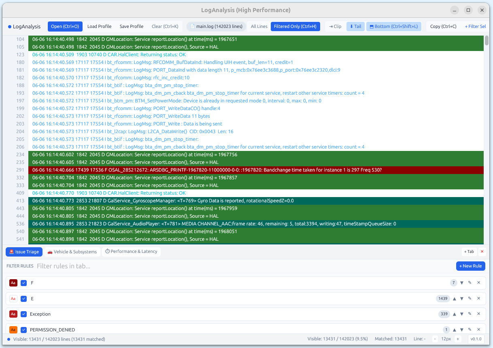
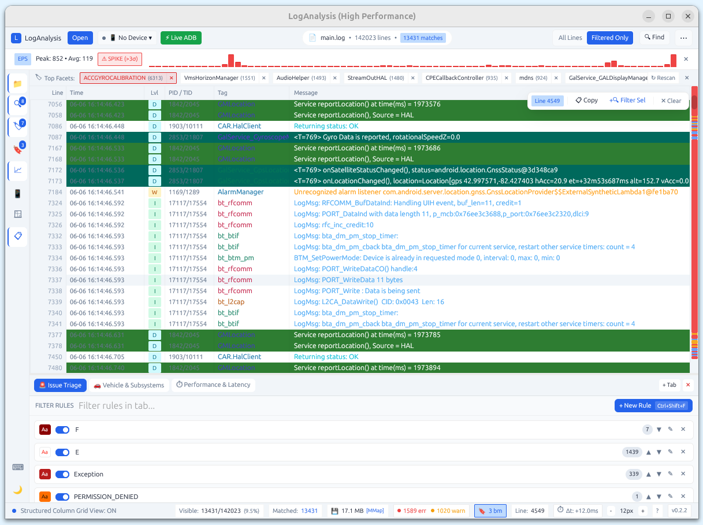
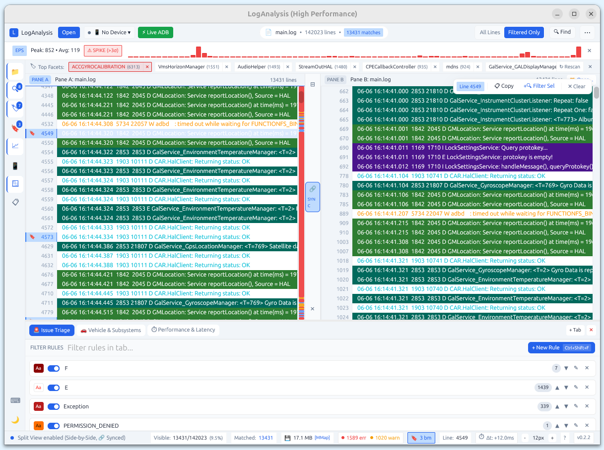
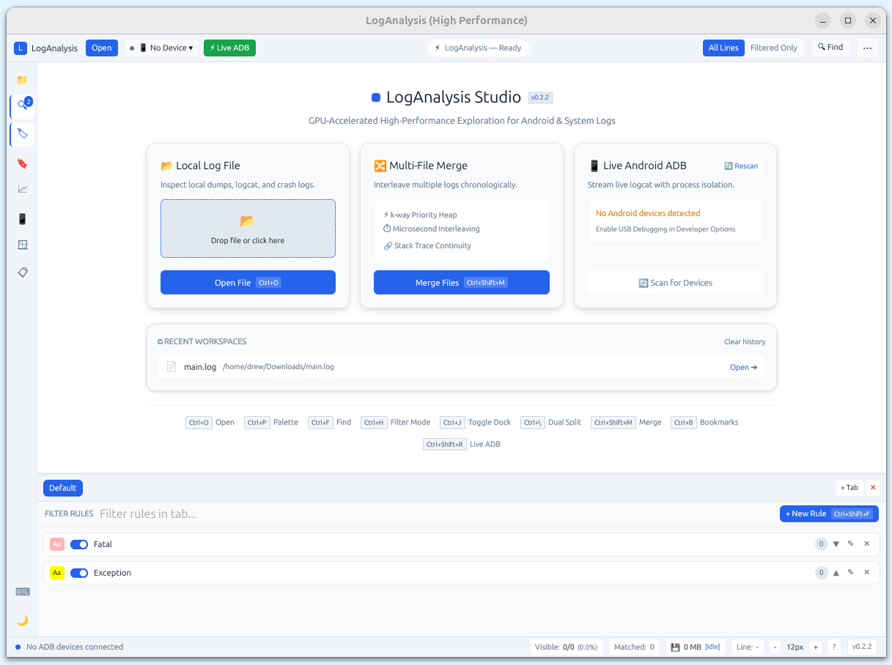
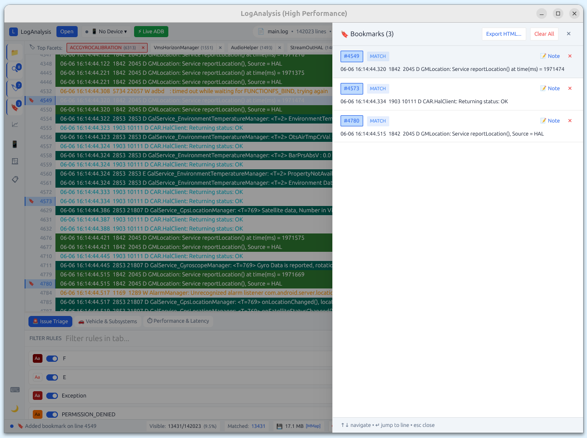

# 🚀 LogAnalysis (High-Performance Rust + GPUI)

[](https://www.rust-lang.org/)
[-blueviolet.svg)](https://gpui.rs/)
[](LICENSE)
[](docs/qa-docs-tests-cleanup.md)

**LogAnalysis** is a surgical, ultra-fast desktop log analysis and real-time Android `adb logcat` exploration tool. Inspired by the classic [TextAnalysisTool](https://textanalysistool.github.io/) and evolved from [loganalysis_gui](https://github.com/hwanjongyu/loganalysis_gui), it is re-engineered from the ground up in **pure Rust** using Zed Industries' GPU-accelerated **GPUI** framework.

---

## 📸 Screenshots

### High-Performance Log Viewer & Multi-Layer Highlighting


| Structured Column View & Real-Time EPS Sparkline | Dual Split View & Cross-Pane Synchronization |
| :---: | :---: |
|  |  |

| Studio Welcome Screen & Multi-File Merge | Interactive Bookmark Drawer & Notes |
| :---: | :---: |
|  |  |

---

## ✨ Key Highlights

- **⚡ GPU-Accelerated Virtualized Viewport (GPUI `uniform_list`)**: Rendered directly via Vulkan / Metal / DirectX 12 using GPUI's virtualized `uniform_list`. Only visible lines inside the viewport are constructed and submitted to the GPU, keeping frame rendering cost $O(\text{viewport})$ rather than proportional to total file line count.
- **🧠 Memory-Mapped & Indexed File Engine (`FileLogBuffer`)**: Uses `memmap2` memory mapping with `memchr` line-offset indexing, a `1024`-entry `RwLock`-guarded `Arc<str>` line cache, and an `open_heap` fallback for volatile/rotating files (`crates/loganalysis-core/src/buffer/file_buffer.rs`).
- **🌊 Copy-on-Write Rolling Stream Buffer (`StreamLogBuffer`)**: Stores live `adb logcat` output in `1024`-line Copy-on-Write (`Arc<Vec<Arc<str>>>`) pages (`STREAM_PAGE_SIZE = 1024`) capped at `MAX_MONITOR_LINES = 200_000` with `MONITOR_TRIM_BATCH = 20_000` hysteresis (`constants.rs`, `stream_buffer.rs`).
- **🚄 Multi-Engine Parallel Filtering (`rayon`)**: Combines `Aho-Corasick` multi-literal matching (`MultiFilterMatcher`), linear DFA `regex::bytes::Regex` (`REGEX_DFA_SIZE_LIMIT = 2MB`), AST-validated `fancy_regex` (`has_nested_repetition`, `FANCY_REGEX_BACKTRACK_LIMIT = 250`, SIMD required-literal pre-filter), and `rayon` parallel evaluation (`filter/matcher.rs`, `filter/engine.rs`).
- **🤖 Real-time Android ADB Streamer**: Streams `adb logcat -v threadtime` with a 200,000-line bounded rolling buffer, burst buffering, device serial sanitization, Linux `PR_SET_PDEATHSIG` isolation, and non-blocking subprocess reaping.
- **🎨 Multi-Tab Filter Profiles & 100% Backward Compatibility**: Organizes filters into tabs, enables/disables filter sets on the fly, and imports legacy JSON profiles from the Python `loganalysis_gui` seamlessly.
- **♿ WCAG 2.1 Contrast Ratio Verification**: Built-in relative luminance calculator warns against unreadable foreground/background color combinations in real-time.

---

## 📊 Architectural Design Comparison (Qualitative)

| Architectural Dimension | **Rust + GPUI (This Project)** | **Rust + Tauri v2** | **Electron** | **Python / PyQt5** |
| :--- | :--- | :--- | :--- | :--- |
| **Memory Architecture** | Zero-copy `memmap2` + line-offset index + 1024-entry `Arc<str>` cache; bounded 200k CoW pages for live streams | Rust backend + WebView DOM/IPC serialization | Chromium multi-process heap + UTF-16 JS string duplication | Python heap objects + Qt model copies |
| **File Ingestion** | Instant OS page mapping (`memmap2`) + `memchr` newline scan (`open_heap` fallback when needed) | Rust I/O + IPC transfer to WebView | Streaming/chunked JS file parsing | Line-by-line Python string decoding |
| **Filter Evaluation** | `Aho-Corasick` multi-literal + 2MB-capped linear DFA regex + AST-guarded `fancy_regex` across `rayon` worker pool | Rust core + WebView result marshaling | Single-threaded JS event loop / WebWorker regex | GIL-bound or subprocess evaluation |
| **UI Rendering Pipeline** | Native GPU rendering (`uniform_list` viewport virtualization, no browser DOM) | System WebView DOM virtualization | Chromium Blink/Skia DOM virtualization | CPU/raster Qt widget painting |
| **Distribution Footprint** | Single native Rust binary (`crates/loganalysis-gui`) | Native binary + system WebView runtime | Bundled Chromium + Node.js runtime | Python interpreter + Qt shared libraries |

---

## 🏗️ Architecture

The workspace is cleanly divided into a decoupled headless core engine and a GPUI desktop front-end:

```
loganalysis/
├── Cargo.toml
├── LICENSE
├── deny.toml
├── docs/
│   ├── INVARIANTS.md                     # Binding system invariants & quality gates
│   ├── spec-docs-tests-cleanup.md        # Documentation, test & deduplication spec
│   └── qa-docs-tests-cleanup.md          # Automated QA verification report
└── crates/
    ├── loganalysis-core/                 # Pure headless Rust library
    │   └── src/
    │       ├── lib.rs                    # Public crate exports
    │       ├── constants.rs              # Buffer limits & filter color maps
    │       ├── error.rs                  # Structured core error types
    │       ├── adb/                      # mod.rs, device.rs, logcat.rs
    │       ├── buffer/                   # mod.rs, file_buffer.rs, stream_buffer.rs,
    │       │                             # merged_buffer.rs, column.rs, timestamp.rs, correlation.rs
    │       ├── export/                   # mod.rs, bookmark.rs, html_report.rs
    │       ├── filter/                   # mod.rs, model.rs, matcher.rs, engine.rs,
    │       │                             # contrast.rs, heatmap.rs, timeline.rs
    │       └── search/                   # mod.rs, searcher.rs, fuzzy.rs
    │
    └── loganalysis-gui/                  # GPUI desktop frontend
        └── src/
            ├── main.rs                   # Thin binary entrypoint
            ├── lib.rs                    # App startup, CLI dispatch, global keybindings
            ├── actions.rs                # Registered GPUI actions
            ├── cli.rs                    # CLI argument & flag parser
            ├── dialogs.rs                # Cross-platform OS file dialogs & X11/Win32 guards
            ├── logging.rs                # Buffered file logging & crash report handler
            ├── selection.rs              # Visible/source row selection model
            ├── theme.rs                  # Light & Dark elevation themes + tag/severity colors
            ├── types.rs                  # Shared state snapshot & panel position types
            ├── components/               # Header, log viewport, filter dock, find bar, status bar, TextInput
            ├── controllers/              # Headless ADB, bookmark, search, and split-view controllers
            ├── modals/                   # Filter rule modal, command palette, bookmark drawer, note modal
            └── workspace/                # LogAnalysisWorkspace handlers, async tasks, atomic persistence
```

---

## 🚀 Getting Started

### Prerequisites

#### Linux (Ubuntu/Debian)
```bash
sudo apt-get update
sudo apt-get install -y build-essential pkg-config libvulkan-dev \
  libx11-xcb-dev libxkbcommon-x11-dev libxkbcommon-dev libasound2-dev \
  libssl-dev libfontconfig1-dev libxcb1-dev libwayland-dev
```

#### macOS
Xcode Command Line Tools are sufficient:
```bash
xcode-select --install
```

### Running the App

```bash
# Clone the repository
git clone https://github.com/hwanjongyu/loganalysis.git
cd loganalysis

# Build and run the desktop app
cargo run --release -p loganalysis-gui
```

#### CLI Usage

```text
loganalysis [OPTIONS] [--] [FILE...]
```

- `-h`, `--help`: Print help information and exit (`0`).
- `-v`, `-V`, `--version`: Print `LogAnalysis <version>` and exit (`0`).
- `--`: Treat all subsequent arguments as file paths (allows filenames starting with `-`).
- Unknown `-...` flags print help to stderr and exit with status `2`.
- Passing **1 file path** opens it directly (`open_file`); passing **2 or more file paths** opens them via chronological multi-file merge (`open_merged_files`).

### Running Tests

Run the full deterministic workspace unit and integration test suites across `loganalysis-core` and `loganalysis-gui`:

```bash
cargo test --workspace
```

---

## ⌨️ Keyboard Shortcuts

| Category | Shortcut | Action |
| :--- | :--- | :--- |
| **File & Merge** | `Ctrl + O` | Open Log File |
| | `Ctrl + Shift + M` / `Cmd + Shift + M` | Open & Chronologically Merge Multiple Log Files |
| **Search & Copy** | `Ctrl + F` | Open / Toggle Find Bar |
| | `F3` / `Shift + F3` | Find Next / Previous Match |
| | `Ctrl + C` | Copy Selected Line to Clipboard |
| **Filter Rules & Profiles** | `Ctrl + H` | Toggle "Filtered Only" vs "All Lines" |
| | `Ctrl + Shift + F` | Add New Filter Rule |
| | `Ctrl + S` | Save Filter Profile (prompts Save As if unsaved) |
| | `Ctrl + Shift + S` | Save Filter Profile As... |
| | `Ctrl + Shift + O` | Load Filter Profile (JSON) |
| | `Ctrl + T` | Add New Filter Tab |
| | `Ctrl + D` | Delete Current Filter Tab |
| | `Ctrl + R` | Rename Current Filter Tab |
| **ADB & Logs** | `Ctrl + Shift + R` / `Cmd + Shift + R` | Start / Stop Live ADB Logcat Stream |
| | `Ctrl + Space` | Pause / Resume Live ADB Streaming |
| | `Ctrl + K` | Clear Loaded Logs |
| **Bookmarks** | `F2` / `Ctrl + F2` | Toggle Bookmark on Selected Line |
| | `Shift + F2` / `Alt + F2` | Jump to Previous / Next Bookmark |
| | `Ctrl + B` / `Cmd + B` | Toggle Bookmark Drawer |
| | `Alt + Enter` | Edit Bookmark Triage Note |
| **Views & Layout** | `Ctrl + P` / `Cmd + P` / `Ctrl + Shift + P` / `Cmd + Shift + P` | Toggle Command Palette |
| | `Ctrl + J` / `Cmd + J` | Toggle Filter Dock Visibility |
| | `Ctrl + Shift + L` | Toggle Filter Dock Position (Bottom / Left) |
| | `Alt + F` | Toggle Forensic Facets Bar |
| | `Ctrl + Shift + T` / `Cmd + Shift + T` | Toggle Throughput EPS Timeline Ribbon |
| | `F11` / `Ctrl + Shift + Z` / `Cmd + Shift + Z` | Toggle Zen Focus Mode |
| | `Ctrl + \` / `Cmd + \` | Toggle Dual-Pane Split View |
| | `Ctrl + Alt + \` | Toggle Split Orientation (Side-by-Side / Stacked) |
| | `Ctrl + Alt + S` | Toggle Timestamp-Synced Lockstep Scrolling |
| | `Ctrl + G` / `Cmd + G` | Toggle Structured Column Grid View |
| | `Alt + Z` | Toggle Full-Line Horizontal Display |
| | `Ctrl + U` / `Cmd + U` / `F10` | Toggle Light / Dark Theme |
| **Zoom** | `Ctrl + =` / `Ctrl + +` | Zoom Font In |
| | `Ctrl + -` | Zoom Font Out |
| | `Ctrl + 0` / `Cmd + 0` | Reset Font Size to 12px |

---

## 📄 License

Distributed under the [MIT License](LICENSE).
