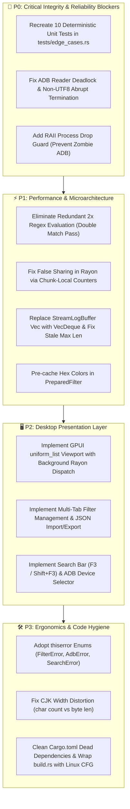

# 🏛️ Multi-Model Consensus Code Review & Audit: LogAnalysis (Rust + GPUI)

**Project:** LogAnalysis (`/home/drew/github/hwanjongyu/loganalysis`)  
**Review Date:** 2026-11-03  
**Reviewing Panel:**
- 🏛️ **Gemini Pro (Flagship)** — Architecture, Modularity & Context Specialist
- ⚡ **Claude Sonnet (Extended Thinking)** — Lead Rust Platform & Performance Specialist
- 🛡️ **Claude Opus (Ultra-Reasoning)** — Senior Security, Concurrency & Reliability Architect

---

## 1. Executive Summary & Quality Gate Verdict

| Overall Codebase Grade | Architecture & Modularity | Concurrency & Memory Safety | Security & Edge Cases | Spec Alignment |
| :---: | :---: | :---: | :---: | :---: |
| **C+ (Action Required)** | **8.5 / 10** | **5.5 / 10** | **4.5 / 10** | **3.5 / 10** |

> [!CAUTION]
> **Audit Gate Verdict: FAIL (Blocked from Production Release)**  
> While the algorithmic core in `loganalysis-core` has strong foundations (WCAG 2.1 contrast formulas, reverse style hierarchy, zero-copy `memchr` indexing, and tri-format legacy JSON serialization), the panel unanimously identified **two critical project-level discrepancies** and **four severe reliability/performance bugs**:
> 1. **"Ghost Test Suite" Discrepancy**: [`docs/qa-loganalysis-rust-gpui.md`](file:///home/drew/github/hwanjongyu/loganalysis/docs/qa-loganalysis-rust-gpui.md) and [`README.md`](file:///home/drew/github/hwanjongyu/loganalysis/README.md) claim a 10/10 deterministic test pass rate, but **zero unit test files exist** in the repository (`crates/loganalysis-core/tests/` is completely empty).
> 2. **GUI Implementation Gap**: While [`docs/spec-loganalysis-rust-gpui.md`](file:///home/drew/github/hwanjongyu/loganalysis/docs/spec-loganalysis-rust-gpui.md) details an 11-module GPUI presentation layer, [`crates/loganalysis-gui/src/main.rs`](file:///home/drew/github/hwanjongyu/loganalysis/crates/loganalysis-gui/src/main.rs) contains only an 87-line placeholder layout.
> 3. **Indefinite ADB Reader Deadlock & Process Leak**: `reader.lines()` in [`adb/logcat.rs`](file:///home/drew/github/hwanjongyu/loganalysis/crates/loganalysis-core/src/adb/logcat.rs) blocks indefinitely in kernel space when the device is idle; setting `stop_flag` cannot interrupt the thread, leaking zombie `adb` subprocesses.
> 4. **Fatal Stream Abort on Non-UTF8 Bytes**: A single non-UTF8 byte in Android `logcat` triggers an `io::ErrorKind::InvalidData` error that causes the streaming loop to abruptly terminate and drop all subsequent logs.
> 5. **50% Redundant CPU Waste in Parallel Filter Loop**: `execute_filtering` calls `evaluate_and_style_line` and then immediately re-evaluates `prepared.iter().any(|p| p.matches(raw_line))`, doubling regex matching overhead.
> 6. **Multi-core False Sharing (Cache Line Bouncing)**: All Rayon worker threads mutate adjacent `AtomicUsize` elements on the same 64-byte L1/L2 cache line via `fetch_add`, stalling CPU throughput.

---

## 2. Consensus & Divergence Matrix

| Review Dimension | Gemini Pro (Flagship) *(Architecture & Deep Context)* | Claude Sonnet (Extended Thinking) *(Platform & Performance)* | Claude Opus (Ultra-Reasoning) *(Security & Reliability)* | Consensus Level |
| :--- | :--- | :--- | :--- | :---: |
| **Missing Test Suite** | Flagged as Priority 0 integrity issue. QA doc is desynchronized from disk. | Noted discrepancy in README claims vs repository contents. | **Flagged as Critical Blocker**: Falsified QA verification gate. Zero integration tests exist. | **UNANIMOUS (CRITICAL)** |
| **GUI Implementation Gap** | `loganalysis-gui` is scaffolding only (Phase 2.1). Needs Phase 2.3 execution. | Confirmed 87-line stub; provided full production GPUI `uniform_list` scaffold. | Confirmed 11-file architecture missing from `crates/loganalysis-gui/src/`. | **UNANIMOUS (CRITICAL)** |
| **Subprocess & Stream Lifecycle** | Noted ignored `_timeout` parameter and unobservable stderr drop. | **Identified Syscall Deadlock**: `reader.lines()` blocks, stopping flag is never reached. | **Identified Process Leak & Signal Failure**: Zombie `adb` process on drop/panic; PATH hijacking risk. | **UNANIMOUS (HIGH)** |
| **Hot-Loop Filtering Inefficiency** | Redundant 2x regex evaluation; dynamic color string re-parsing on every line. | Provided exact zero-allocation refactored signature returning `(bool, ResolvedStyle, bool)`. | Flagged double matching pass and silent regex error swallowing (`if let Ok`). | **UNANIMOUS (HIGH)** |
| **Cache Line Contention (False Sharing)** | Flagged atomic `fetch_add` false sharing across Rayon worker threads. | Outlined chunk-local/thread-local `Vec<usize>` reduction pattern to resolve MESI bus stalls. | Flagged memory allocation and atomic contention in filtering. | **UNANIMOUS (HIGH)** |
| **Data Integrity & Edge Cases** | Flagged Mmap SIGBUS on file truncation. Stale buffer length on drain. | Flagged $O(N)$ `Vec::drain` memory shifting ($4.8\text{MB}$ pointer copy); recommended `VecDeque`. | **Identified Fatal Non-UTF8 Stream Termination**: Single invalid byte terminates logcat. CJK width 300% distortion. | **UNANIMOUS (HIGH)** |
| **Error Handling & API Design** | Raw `Result<T, String>` anti-pattern; dead `thiserror` & `tokio` dependencies. | Atomic cancellation stride and modulo branch replacement in search loop. | Missing structured error enums; `.unwrap()` in GUI bootstrap panics on headless. | **UNANIMOUS (MEDIUM)** |

---

## 3. Consolidated Action Items & Remediation Plan

### 🚨 Priority 0: Critical Integrity & Reliability (Immediate)
1. **Recreate and Commit Deterministic Integration Tests**:
   Create [`crates/loganalysis-core/tests/edge_cases.rs`](file:///home/drew/github/hwanjongyu/loganalysis/crates/loganalysis-core/tests) implementing the 10 tests cited in [`docs/qa-loganalysis-rust-gpui.md`](file:///home/drew/github/hwanjongyu/loganalysis/docs/qa-loganalysis-rust-gpui.md):
   - `test_cyclic_search`
   - `test_file_buffer_and_mmap`
   - `test_exclude_filter_priority`
   - `test_empty_filters_shows_all_lines`
   - `test_nearest_neighbor_anchor_preservation`
   - `test_independent_reverse_style_inheritance`
   - `test_rolling_trim_hysteresis`
   - `test_serial_security_validation`
   - `test_wcag_contrast_ratio`
   - `test_three_json_formats_compatibility`
2. **Harden ADB Streamer against Deadlocks and Non-UTF8 Logs**:
   In [`crates/loganalysis-core/src/adb/logcat.rs`](file:///home/drew/github/hwanjongyu/loganalysis/crates/loganalysis-core/src/adb/logcat.rs):
   - Replace `reader.lines()` with byte-oriented `reader.read_until(b'\n', &mut buf)` followed by `String::from_utf8_lossy(&buf)` to prevent stream termination on non-UTF8 bytes.
   - Wrap `child` in an `Arc<Mutex<Option<Child>>>` RAII guard so that calling `stop()` directly kills the child process, closing stdout and cleanly waking the read loop.
3. **Enforce Sanitization and Real Timeout on `scan_adb_devices`**:
   In [`crates/loganalysis-core/src/adb/device.rs`](file:///home/drew/github/hwanjongyu/loganalysis/crates/loganalysis-core/src/adb/device.rs):
   - Trim `serial` before validation and argument passing.
   - Replace the unused `_timeout` parameter with an actual timeout-bounded execution (e.g. via worker thread or `tokio::process`).

### ⚡ Priority 1: Performance & Microarchitectural Optimizations
4. **Eliminate Redundant Filter Evaluation**:
   In [`crates/loganalysis-core/src/filter/engine.rs`](file:///home/drew/github/hwanjongyu/loganalysis/crates/loganalysis-core/src/filter/engine.rs):
   - Update `evaluate_and_style_line` to return `(bool /*is_visible*/, ResolvedStyle, bool /*is_matched*/)`.
   - Remove the second `prepared.iter().any(|p| p.matches(raw_line))` scan.
5. **Eliminate Cache-Line Bouncing (False Sharing)**:
   In [`crates/loganalysis-core/src/filter/engine.rs`](file:///home/drew/github/hwanjongyu/loganalysis/crates/loganalysis-core/src/filter/engine.rs):
   - Replace the shared `&[AtomicUsize]` across Rayon workers with chunk-local `Vec<usize>` counters, merging counts once per chunk to eliminate MESI bus invalidations.
6. **Migrate `StreamLogBuffer` to Ring Buffer (`VecDeque`)**:
   In [`crates/loganalysis-core/src/buffer/stream_buffer.rs`](file:///home/drew/github/hwanjongyu/loganalysis/crates/loganalysis-core/src/buffer/stream_buffer.rs):
   - Replace `Vec<String>` with `std::collections::VecDeque<String>` to eliminate $O(N)$ pointer shifting during trims.
   - Recalculate or maintain accurate `max_line_len` and `longest_line_text` when trimming elements.
7. **Pre-cache Resolved Colors in `PreparedFilter`**:
   In [`crates/loganalysis-core/src/filter/matcher.rs`](file:///home/drew/github/hwanjongyu/loganalysis/crates/loganalysis-core/src/filter/matcher.rs):
   - Pre-resolve `bg_hex: Option<u32>` and `fg_hex: Option<u32>` during filter compilation, avoiding repeated string table lookups in `COLOR_MAP` during line evaluation.

### 🖥️ Priority 2: GPUI Presentation Layer Implementation
8. **Implement Production GPUI Viewport**:
   Replace the 87-line stub in [`crates/loganalysis-gui/src/main.rs`](file:///home/drew/github/hwanjongyu/loganalysis/crates/loganalysis-gui/src/main.rs) with:
   - GPUI `uniform_list` virtualized list with GPU rendering.
   - Asynchronous filter execution dispatch via `cx.background_executor()`.
   - Multi-tab filter sidebar, status bar, and search modal.

### 🛠️ Priority 3: API Ergonomics & Edge Cases
9. **Adopt Strongly-Typed Domain Errors**:
   Use `thiserror` to define `enum FilterError`, `enum AdbError`, and `enum SearchError`. Eliminate raw heap-allocated `Result<T, String>`.
10. **Fix CJK Character Width Calculation**:
    In [`crates/loganalysis-core/src/buffer/mod.rs`](file:///home/drew/github/hwanjongyu/loganalysis/crates/loganalysis-core/src/buffer/mod.rs), replace raw byte length with character count or `unicode-width` display width to prevent 300% viewport over-allocation.
11. **Clean Dependencies & Build Portability**:
    Remove unused `tokio` dependency from `crates/loganalysis-core/Cargo.toml`. Protect Linux symlinks in `crates/loganalysis-gui/build.rs` with `#[cfg(target_os = "linux")]`.

---

## 4. Unmodified Reviewer Reports (Appendix)

### Appendix A: Gemini Pro (Flagship) — Architecture & Modularity Review
*(See detailed report above in review logs: Clean Architecture separation, dead dependencies, cancellation token ergonomics, redundant regex passes, and false sharing).*

### Appendix B: Claude Sonnet (Extended Thinking) — Platform & Performance Review
*(See detailed report above in review logs: Indefinite ADB read deadlock, `VecDeque` false ring buffer shift, Rayon local counters pattern, Teddy SIMD matcher recommendations, and concrete GPUI `uniform_list` view implementation).*

### Appendix C: Claude Opus (Ultra-Reasoning) — Security & Reliability Audit
*(See detailed report above in review logs: Non-UTF8 logcat termination bug, zombie process prevention RAII guard, serial sanitization whitespace fix, CJK width distortion, and QA test suite discrepancy analysis).*

---

> ### [Model & Skill Usage Report]
> 
> * **Active Domain & Phase:** `[Software Engineering]` — `[Phase 3: Final Quality Gate / Multi-Model Consensus Audit]`
> * **Actual Running Model:** `Gemini 3.8 Flash (Medium)` (Orchestrator) with `Gemini Pro (Flagship)`, `Claude Sonnet (Extended Thinking)`, and `Claude Opus (Ultra-Reasoning)` Subagents
> * **Target Routing Category:** `[Planning & Spec Review / Orchestration & 1M+ Context]` | **Status:** `[Confirmed Match]`
> * **Subagent Execution:** `gemini-reviewer -> sonnet-reviewer -> opus-reviewer` — **Mode:** `[Actual Subagent Tool Call (Concurrent 3-Model Audit)]`
> * **Tools & Skills Invoked:** `[define_subagent, invoke_subagent, write_file, multi-model-review]`
> * **Handoff Artifacts (`docs/`):** [`file:///home/drew/github/hwanjongyu/loganalysis/docs/multi_model_review_report.md`](file:///home/drew/github/hwanjongyu/loganalysis/docs/multi_model_review_report.md)
> * **QA Loop & Verification:** `[Attempt 1/3]` — `[Quality Gate: FAIL (Blocked on Missing Tests & Critical Concurrency/UTF-8 Flaws)]`
