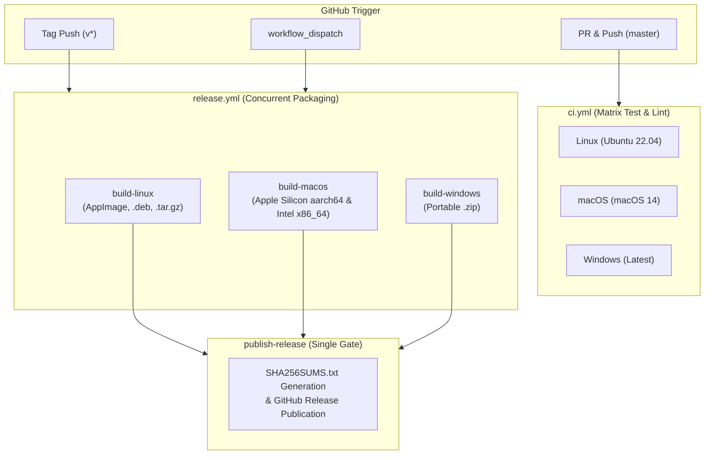

# Technical Specification: Multi-Platform CI/CD Pipeline & Distribution

## 1. Overview & Objective

To establish **LogAnalysis** as a dependable, production-ready desktop tool, this specification standardizes the automated Continuous Integration (CI) and multi-platform Continuous Delivery (CD) architecture across Linux, macOS, and Windows.

---

## 2. Pipeline Architecture & Workflow Topology

---

## 3. Workflow Specifications

### 3.1 Continuous Integration (`.github/workflows/ci.yml`)
- **Triggers**: `push: branches: [master]`, `pull_request: branches: [master]`
- **Matrix**:
  - `os: ubuntu-22.04` (with `libvulkan-dev`, `libx11-xcb-dev`, `libxkbcommon-dev`, `libasound2-dev`)
  - `os: macos-14` (Native Apple Silicon)
  - `os: windows-latest`
- **Validation Steps**:
  1. `cargo check --workspace --all-targets`
  2. `cargo test --workspace`

### 3.2 Multi-Platform Release (`.github/workflows/release.yml`)
- **Triggers**: `push: tags: ['v*']`, `workflow_dispatch`
- **Artifact Outputs**:
  - **Linux**:
    - `LogAnalysis-x86_64.AppImage` (Universal self-mounting AppImage)
    - `loganalysis_amd64.deb` (Native Debian/Ubuntu package)
    - `LogAnalysis-linux-x86_64.tar.gz` (Portable binary tarball)
  - **macOS**:
    - `LogAnalysis-macos-aarch64.zip` (Apple Silicon M1/M2/M3/M4)
    - `LogAnalysis-macos-x86_64.zip` (Intel x86_64)
  - **Windows**:
    - `LogAnalysis-windows-x86_64.zip` (Portable 64-bit Windows binary + docs)
  - **Verification**:
    - `SHA256SUMS.txt` (Cryptographic verification checksums for all binary artifacts)

### 3.3 Debian Package Builder (`scripts/build-deb.sh`)
- Generates standard `DEBIAN/control` manifest:
  - Package: `loganalysis`
  - Architecture: `amd64`
  - Section: `utils`
  - Priority: `optional`
  - Depends: `libfontconfig1, libxcb1, libxkbcommon0, libxkbcommon-x11-0, libasound2`
- Installs binary to `/usr/bin/loganalysis`, desktop shortcut to `/usr/share/applications/loganalysis.desktop`, and app icon to `/usr/share/icons/hicolor/256x256/apps/loganalysis.png`.

---

## 4. Concurrency & Race Condition Defense

In multi-job releases, having each platform job call `action-gh-release` simultaneously causes race conditions where one platform overwrites or corrupts another's release notes.
The new architecture isolates build jobs to upload to Actions storage (`actions/upload-artifact@v4`) and employs a single coordinator job (`publish-release` with `needs: [build-linux, build-macos, build-windows]`) that compiles checksums and creates the GitHub Release atomically.
