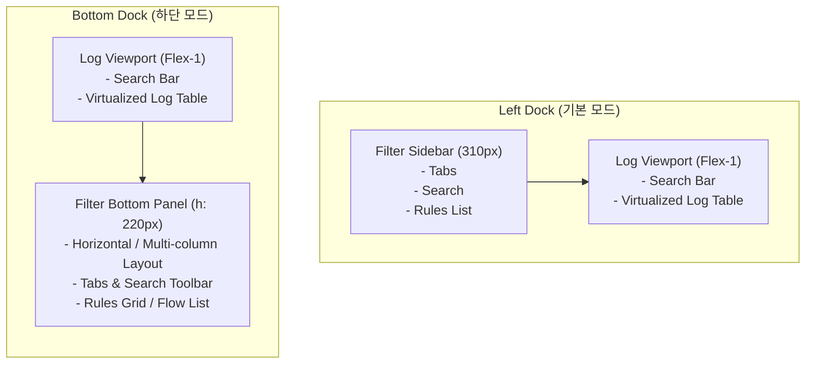

# Spec: Configurable Filter Panel Position (Left vs. Bottom Dock)

## 1. 개요 및 목적
기존의 `LogAnalysis` UI는 필터 탐색기(탭, 규칙 리스트, 규칙 검색 등)가 좌측 사이드바(`Left Panel`, 너비 310px 고정)에 위치하도록 고정되어 있습니다.
사용자가 모니터 가로폭이 넓은 환경(Ultra-wide)과 세로 길이가 긴 로그 분석 환경(세로 정렬 선호)에 맞춰 필터 패널의 위치를 **왼쪽(Left Dock)** 또는 **아래쪽(Bottom Dock)** 으로 유연하게 전환할 수 있도록 지원합니다.

---

## 2. 사용자 경험 (UX) 및 인터랙션 디자인

### 2.1 토글 컨트롤 배치
- **상단 툴바의 뷰 모드 컨트롤 영역**에 필터 패널 독 위치 토글 버튼 추가:
  - 레이블: `◨ Left` (현재 좌측 배치일 때) ↔ `⬒ Bottom` (현재 하단 배치일 때)
  - 단축키: `Ctrl+Shift+L` 또는 `Ctrl+L` (단축키 바인딩 및 도움말 안내 추가)
- 상태 텍스트 피드백:
  - "Switched Filter Panel to Left Dock"
  - "Switched Filter Panel to Bottom Dock"

### 2.2 레이아웃 모드 비교



---

## 3. 세부 기술 아키텍처 및 구현 계획

### 3.1 상태 모델 확장 (`crates/loganalysis-gui/src/main.rs`)
```rust
#[derive(Debug, Clone, Copy, PartialEq, Eq, Serialize, Deserialize)]
pub enum FilterPanelPosition {
    Left,
    Bottom,
}

pub struct LogAnalysisWorkspace {
    // ... 기존 필드 ...
    pub filter_panel_position: FilterPanelPosition,
    // ...
}
```

### 3.2 단축키 및 액션 등록
- 새 GPUI 액션 정의:
  ```rust
  actions!(loganalysis_gui, [
      // ... 기존 액션 ...
      ToggleFilterPanelPosition,
  ]);
  ```
- 키 바인딩 등록:
  `KeyBinding::new("ctrl-shift-l", ToggleFilterPanelPosition, None)`
- 토글 함수 구현:
  ```rust
  pub fn toggle_filter_panel_position(&mut self, cx: &mut Context<Self>) {
      self.filter_panel_position = match self.filter_panel_position {
          FilterPanelPosition::Left => FilterPanelPosition::Bottom,
          FilterPanelPosition::Bottom => FilterPanelPosition::Left,
      };
      self.status_text = format!("Filter Panel docked to {:?}", self.filter_panel_position).into();
      cx.notify();
  }
  ```

### 3.3 렌더링 파이프라인 분기 (`render` 구조 개선)
1. **공통 필터 패널 컴포넌트 메서드 분리**:
   - `render_filter_panel(&mut self, is_bottom: bool, cx: &mut Context<Self>) -> impl IntoElement`
   - 좌측일 때는 `w(px(310.0)).h_full()` 세로 리스트
   - 하단일 때는 `h(px(220.0)).w_full()` 가로/그리드 스크롤 리스트
2. **Main Body 레이아웃 전환**:
   ```rust
   // FilterPanelPosition::Left 일 때:
   div().flex().flex_row()
       .child(self.render_filter_panel(false, cx))
       .child(self.render_log_viewport(cx))

   // FilterPanelPosition::Bottom 일 때:
   div().flex().flex_col()
       .child(self.render_log_viewport(cx))
       .child(self.render_filter_panel(true, cx))
   ```

---

## 4. 검증 계획 (QA & Test Criteria)
1. **컴파일 및 타입 검증**:
   - `cargo check -p loganalysis-gui`
2. **레이아웃 렌더링 무결성**:
   - 토글 시 화면 떨림이나 거터 붕괴 없이 로그 뷰포트 크기가 부드럽게 재계산되는지 확인
   - 하단 모드에서 룰 카드가 가로 랩/스크롤 형태로 정상 배치되는지 확인
3. **단축키 및 상태 전환 동작**:
   - `Ctrl+Shift+L` 누를 때 즉각적인 전환 및 상태바 안내 메시지 검증
4. **회귀 테스트**:
   - `cargo test --workspace` (17개 테스트 통과 유지)
