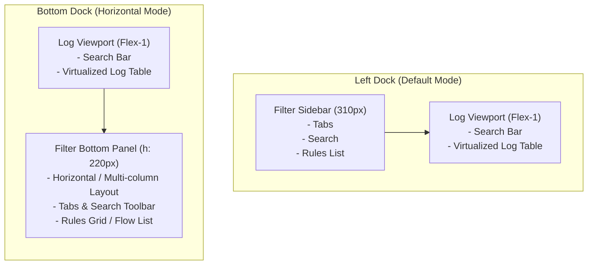

# Spec: Configurable Filter Panel Position (Left vs. Bottom Dock)

## 1. Overview & Objective
Previously, the `LogAnalysis` UI fixed the filter panel (tabs, rule lists, rule search) to a static left sidebar (`Left Panel`, fixed width 310px).
To accommodate both ultra-wide monitors (horizontal space abundance) and vertical log investigation environments (prioritizing maximum vertical trace height), this specification introduces dynamic switching of the filter panel between **Left Dock** and **Bottom Dock**.

---

## 2. User Experience (UX) & Interaction Design

### 2.1 Toggle Controls
- **Toolbar View Mode Control Area**: Filter panel position toggle button:
  - Label: `◨ Left` (when currently left-docked) ↔ `⬒ Bottom` (when currently bottom-docked)
  - Keybinding: `Ctrl+Shift+L` or `Ctrl+L` (registered with shortcut cheat sheet help)
- Status text feedback:
  - "Switched Filter Panel to Left Dock"
  - "Switched Filter Panel to Bottom Dock"

### 2.2 Layout Modes Comparison



---

## 3. Technical Architecture & Implementation Details

### 3.1 State Model Extension (`crates/loganalysis-gui/src/types.rs`)
```rust
#[derive(Debug, Clone, Copy, PartialEq, Eq, Default)]
pub enum FilterPanelPosition {
    Left,
    #[default]
    Bottom,
}

pub struct LogAnalysisWorkspace {
    // ...
    pub filter_panel_position: FilterPanelPosition,
    // ...
}
```

### 3.2 Action Registration & Keybinding
- GPUI action definition:
  ```rust
  actions!(loganalysis_gui, [
      ToggleFilterPanelPosition,
  ]);
  ```
- Keybinding registration:
  `KeyBinding::new("ctrl-shift-l", ToggleFilterPanelPosition, None)`
- Toggle function:
  ```rust
  pub fn toggle_filter_panel_position(&mut self, cx: &mut Context<Self>) {
      self.filter_panel_position = match self.filter_panel_position {
          FilterPanelPosition::Left => FilterPanelPosition::Bottom,
          FilterPanelPosition::Bottom => FilterPanelPosition::Left,
      };
      self.status_text = format!("Filter Panel docked to {:?}", self.filter_panel_position).into();
      cx.notify();
  }
  ```

### 3.3 Layout Rendering Pipeline
1. **Filter Panel Component Separation**:
   - `render_filter_dock(workspace, is_bottom, cx) -> impl IntoElement`
   - When Left: `w(px(310.0)).h_full()` vertical list
   - When Bottom: `h(px(220.0)).w_full()` horizontal flow/grid list
2. **Main Workspace Layout Switching**:
   ```rust
   // FilterPanelPosition::Left:
   div().flex().flex_row()
       .child(render_filter_dock(self, false, cx))
       .child(render_log_viewport(self, true, cx))

   // FilterPanelPosition::Bottom:
   div().flex().flex_col()
       .child(render_log_viewport(self, true, cx))
       .child(render_filter_dock(self, true, cx))
   ```

---

## 4. Verification Plan (QA & Test Criteria)
1. **Compilation & Type Verification**:
   - `cargo check -p loganalysis-gui`
2. **Layout Rendering Integrity**:
   - Verify viewport smoothly recalculates dimensions without gutter collapse on toggle.
   - Verify filter rules wrap and scroll horizontally in bottom dock mode.
3. **Shortcut & State Switching**:
   - Validate `Ctrl+Shift+L` triggers immediate dock toggle with status message feedback.
4. **Regression Testing**:
   - `cargo test --workspace`
