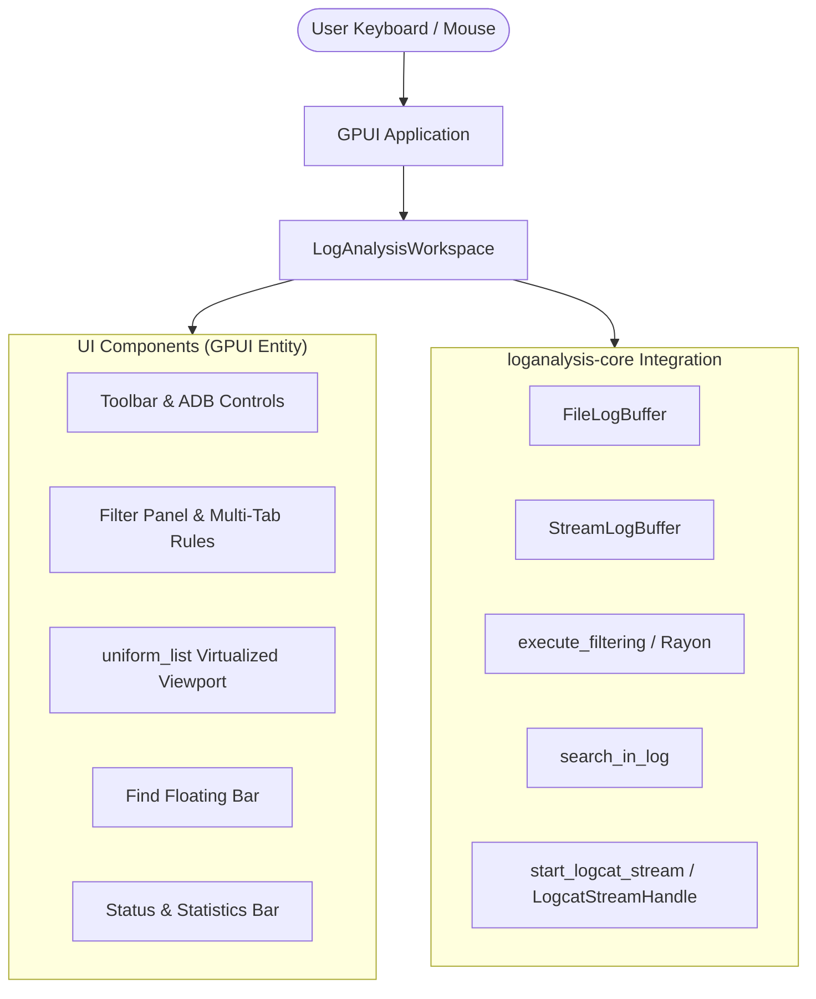

# 🖥️ P2 Implementation Specification: GPUI Desktop Frontend Architecture

- **Version:** 1.0.0
- **Scope:** Priority 2 Implementation (`crates/loganalysis-gui`)
- **Status:** Approved for Implementation

---

## 1. Problem Statement & Architecture Goals

The desktop frontend `crates/loganalysis-gui` was previously a stub window. The goal of P2 is to implement a complete, GPU-accelerated desktop log analysis UI using Zed Industries' GPUI framework (`gpui 0.2.2`).

### Core Architecture Components
1. **`actions.rs`**: GPUI Action definitions for keyboard shortcuts (`Ctrl+O`, `Ctrl+F`, `F3`, `Shift+F3`, `Ctrl+H`, `Escape`).
2. **`theme.rs`**: Color constants matching `loganalysis_gui` (Dark background `#1a1a1e`, Toolbar `#121214`, Gutter `#26262b`, Selection `#2d3748`, Highlight `#3e2723`).
3. **`selection.rs`**: Line selection model (single selection, anchor tracking).
4. **`workspace.rs`**: Main stateful entity orchestrating `LogSource` (`FileLogBuffer` or `StreamLogBuffer`), background Rayon filtering, cyclic search, and ADB live streaming.
5. **Views (`views/`)**:
   - **`log_list.rs`**: High-performance $O(1)$ GPU-rendered `uniform_list` viewport with line number gutter and styling.
   - **`filter_panel.rs`**: Multi-tab filter sidebar with rule checkboxes, exclude indicators, and JSON profile import/export.
   - **`find_modal.rs`**: Search bar with forward/backward search buttons, regex toggle, and case-sensitivity toggle.
   - **`toolbar.rs`**: File open button, Show Only Filtered toggle (`Ctrl+H`), ADB device dropdown, and live stream control.
   - **`status_bar.rs`**: Real-time line count, matched line count, streaming indicator, and current file name.

---

## 2. Interaction Flows & Data Flow

---

## 3. Verification Plan

1. Verify compilation with `cargo check -p loganalysis-gui` and `cargo build -p loganalysis-gui`.
2. Run automated workspace tests `cargo test --workspace`.
3. Verify headless and simulated GUI execution without panics.
