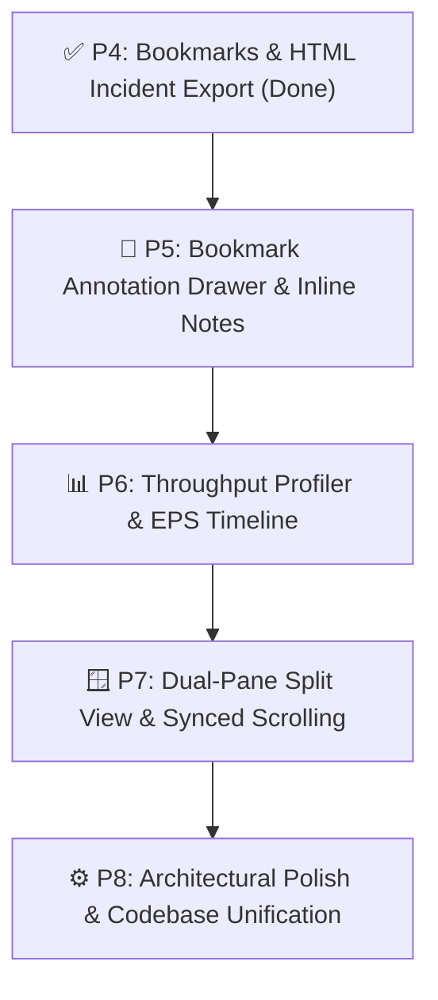

# Future Roadmap & Engineering Backlog Specification (`P5` ~ `P8`)

**Project:** LogAnalysis (High-Performance GPU-Accelerated Rust + GPUI)  
**Author:** Software Architecture Team  
**Date:** 2026-11-06  
**Status:** **PROPOSED (Awaiting User Prioritization)**  

---

## 1. Executive Vision & Architecture Alignment

With the completion of **P0 (Scrollbar Heatmap)**, **P1 (Line Delta Time)**, **P2 (Command Palette)**, **P3 (Multi-Platform CI/CD)**, and **P4 (Bookmarks & HTML Reports)**, **LogAnalysis** has evolved from a fast desktop log reader into an enterprise-grade incident triage platform.

This backlog defines the next evolution phases (`P5` ~ `P8`), focused on:
1. **Deeper Context Attribution:** Turning raw pinned lines into rich, documented incident timelines.
2. **Temporal & Throughput Analytics:** Visualizing log burstiness, ANR stalls, and event storms.
3. **Multi-Stream Comparative Triage:** Correlating paired streams (e.g., Client $\leftrightarrow$ Server, Main Logcat $\leftrightarrow$ Event Log).
4. **Core Engine Hardening:** Resolving remaining items from the multi-model architecture review.

---

## 2. Prioritized Roadmap Overview

---

## 3. Detailed Phase Specifications

### 🎯 Phase 5: Bookmark Annotation Drawer & Inline Notes (`P5`)
> **Goal:** Bridge the gap between bookmark pinning and rich incident reporting by allowing engineers to attach triage notes directly from the keyboard.

- **5.1 Functional Requirements:**
  - **Inline Note Input (`Enter` / `Shift+Enter` on Bookmarked Line):** Pressing `Enter` on a bookmarked row or clicking the gutter icon opens a floating popover input to write/update root-cause annotations.
  - **Bookmark Drawer Modal (`Ctrl+B` / Palette):** A slide-over panel on the right displaying all bookmarks chronologically, grouped by severity (`Error`, `Warning`, `Normal`), with instant jump-to-line on click.
  - **Live Persistence in HTML Report:** Notes entered in the UI immediately propagate to `generate_html_report(&options)`.
- **5.2 Technical Architecture:**
  - Extend `BookmarkManager`: `set_note(source_idx: usize, note: String)`.
  - Component: `crates/loganalysis-gui/src/modals/bookmark_drawer.rs`.
  - Storage: Export/Import bookmarks along with filter profiles in `.json`.

---

### 📊 Phase 6: Log Throughput Profiler & EPS Timeline (`P6`)
> **Goal:** Provide instant spatial situational awareness for anomalous logging spikes (e.g., infinite loops, runaway stack traces, broadcast storms).

- **6.1 Functional Requirements:**
  - **EPS Sparkline Ribbon:** A collapsible 36px timeline ribbon beneath the toolbar plotting Events Per Second ($\text{EPS}$) and error density across time buckets.
  - **Interactive Scrubber / Seek:** Clicking any bucket in the timeline smoothly centers the log viewport on the first log line within that time window.
  - **Anomaly Highlighting:** Buckets where $\text{EPS} > 3\sigma$ (3 standard deviations above baseline) automatically render with amber/red caution tinting.
- **6.2 Technical Architecture:**
  - Engine: `crates/loganalysis-core/src/filter/timeline.rs` with parallel Rayon bucket reduction over parsed `LogTimestamp`s.
  - GPU Rendering: GPUI path elements (`cx.paint_path()`) or segmented div-bars for 60 FPS microsecond rendering.

---

### 🪟 Phase 7: Dual-Pane Split View & Synced Scrolling (`P7`)
> **Goal:** Enable cross-system causal analysis by placing two active log sources side-by-side.

- **7.1 Functional Requirements:**
  - **Split View Configurations:** Vertical (Left | Right) or Horizontal (Top / Bottom) split via `Ctrl+\`.
  - **Dual Log Sources:** Pane A (e.g., Device A / Logcat) and Pane B (e.g., Device B / Server Access Log) each with independent filter rules and search handles.
  - **Lockstep Timestamp Synchronization:** Option to link scrolling so that scrolling Pane A automatically aligns Pane B to the closest matching microsecond timestamp.
- **7.2 Technical Architecture:**
  - Workspace Refactor: Transition `LogAnalysisWorkspace` from single `log_source` to `Vec<LogPaneState>` or `ActivePanes { primary: LogPane, secondary: Option<LogPane> }`.
  - Synchronization: Fast binary search on monotonically increasing timestamps.

---

### ⚙️ Phase 8: Architectural Polish & Engine Hardening (`P8`)
> **Goal:** Close out technical debt identified in `docs/multi_model_review_report.md`.

- **8.1 Tasks:**
  - **P8-A: Replace `FilterRuleSearch` string tracking with `Entity<TextInput>`:** Unify all text input fields under GPUI's native IME-capable `TextInput` component.
  - **P8-B: Sync `INVARIANTS.md` buffer limits:** Synchronize `200k` lines vs `20k` monitor buffer limits between documentation and constant definitions.
  - **P8-C: `FileLogBuffer` Line Cache:** Add an LRU cache for decompressed line slices to optimize ultra-high-rate wheel scrolling on 10M+ line files.

---

## 4. Suggested Implementation Strategy

| Task | Estimated Complexity | Core Value | Recommendation |
| :--- | :---: | :--- | :--- |
| **P5 (Bookmark Notes & Drawer)** | 🟡 Medium | High (Completes incident triage workflow) | **Immediate Next Pick** |
| **P6 (EPS Timeline Profiler)** | 🟠 Medium-High | High (Visual bottleneck detection) | Secondary |
| **P7 (Dual-Pane Split View)** | 🔴 High | Very High (Enterprise multi-device triage) | Future Milestone |
| **P8 (Architectural Hardening)** | 🟢 Low-Medium | Code Quality & Maintainability | Continuous Background |
