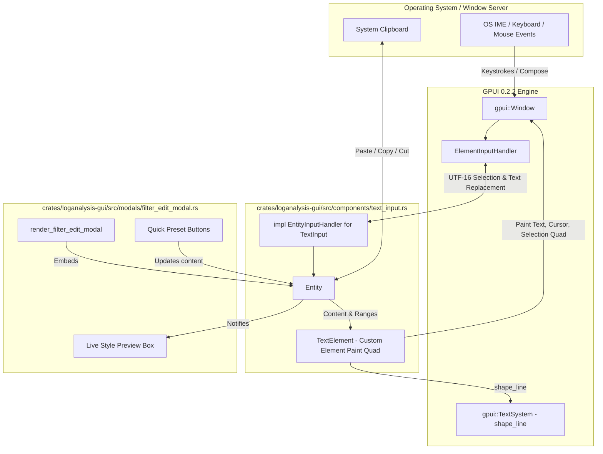

# Technical Specification: GPUI Native TextInput with EntityInputHandler

## 1. Overview & Motivation
Currently, text input in `crates/loganalysis-gui/src/modals/filter_edit_modal.rs` is a manually crafted "fake input" composed of individual character `div` elements, a hardcoded 2px cursor quad, and manual keystroke routing in `workspace.rs`. This architecture causes:
- Incomplete OS IME integration (Korean/CJK composition jitter or missing pre-edit underline).
- Lack of mouse drag text selection, double-click word selection, and native cursor placement.
- Character width squishing or misalignment across different platforms and fonts.

This specification defines the implementation of a reusable, native-grade `TextInput` component utilizing GPUI 0.2.2's `EntityInputHandler`, mirroring the architecture used by Zed and GPUI's official text input specification.

---

## 2. Architecture & Call Paths



---

## 3. Component Design (`crates/loganalysis-gui/src/components/text_input.rs`)

### 3.1 Data Structures
```rust
pub struct TextInput {
    pub focus_handle: FocusHandle,
    pub content: SharedString,
    pub placeholder: SharedString,
    pub selected_range: Range<usize>,
    pub selection_reversed: bool,
    pub marked_range: Option<Range<usize>>, // OS IME composition range
    pub last_layout: Option<ShapedLine>,
    pub last_bounds: Option<Bounds<Pixels>>,
    pub is_selecting: bool,
}
```

### 3.2 `EntityInputHandler` Protocol Implementation
- `text_for_range`: Translates UTF-16 ranges requested by the OS IME to UTF-8 byte ranges and returns the substring.
- `selected_text_range`: Reports the active `UTF16Selection` to the OS.
- `marked_text_range`: Returns the active IME composition range (with native underline styling).
- `unmark_text`: Commits or cancels the active composition.
- `replace_text_in_range`: Replaces characters upon committed input or paste.
- `replace_and_mark_text_in_range`: Updates in-flight IME composition (e.g. Korean Hangul syllable assembly).
- `bounds_for_range`: Projects the text range into screen pixel coordinates for OS IME candidate window placement.
- `character_index_for_point`: Converts mouse click pixel coordinates to UTF-8/UTF-16 character indices using `ShapedLine::index_for_x`.

### 3.3 Custom `TextElement` Rendering
- Layout: Computed via `window.request_layout(style, [], cx)` with height matching `window.line_height()`.
- Prepaint: Shapes text line via `window.text_system().shape_line(display_text, font_size, &runs, None)`.
  - Cursor quad: Painted as a `px(2.0)` bar at `line.x_for_index(cursor)`.
  - Selection quad: Painted as a highlight background box from `line.x_for_index(start)` to `line.x_for_index(end)`.
  - IME underline: Marked text run styled with `UnderlineStyle`.
- Paint: Delegates input capture to `window.handle_input(&focus_handle, ElementInputHandler::new(bounds, self.input.clone()), cx)`.

---

## 4. Integration into Filter Edit Modal

1. **Workspace Entity State**:
   - `Workspace` manages `pub modal_pattern_input: Entity<TextInput>`.
   - On `open_add_filter_modal`: `modal_pattern_input.update(cx, |input, cx| input.set_text("", cx))`.
   - On `open_edit_filter_modal`: `modal_pattern_input.update(cx, |input, cx| input.set_text(&rule.text, cx))`.
2. **Modal Rendering**:
   - Replace lines 120–315 of `crates/loganalysis-gui/src/modals/filter_edit_modal.rs` with:
     ```rust
     div()
         .id("input-modal-pattern")
         .w_full()
         .px(px(10.0))
         .py(px(8.0))
         .bg(theme.bg_dark)
         .border_1()
         .border_color(if is_modal_focused { theme.accent } else { theme.border })
         .rounded_md()
         .child(modal_pattern_input.clone())
     ```
3. **Workspace Keyboard Delegation Cleanup**:
   - Remove manual `left`, `right`, `home`, `end`, `backspace`, `delete`, `space`, and character insertion for `InputFocusTarget::ModalPattern` in `workspace.rs`.
   - Native keybindings and actions (`Backspace`, `Delete`, `Left`, `Right`, `SelectLeft`, `SelectRight`, `SelectAll`, `Home`, `End`, `Copy`, `Paste`, `Cut`) are natively dispatched to `TextInput`.
4. **Preset and Save Sync**:
   - Clicking quick presets updates `modal_pattern_input.content`.
   - Saving the rule reads `modal_pattern_input.read(cx).text()`.

---

## 5. Edge Cases & Safeguards

1. **IME Korean Syllable Boundary Safety**:
   - `replace_and_mark_text_in_range` and `replace_text_in_range` strictly compute byte offsets via `range_from_utf16` and `grapheme_indices` to prevent slicing inside multi-byte UTF-8 boundaries.
2. **Focus Handshake**:
   - When the modal opens, `window.focus(&modal_pattern_input.read(cx).focus_handle)`.
   - When the modal closes, focus is returned to `workspace.focus_handle`.
3. **Copy / Paste Multi-line Sanitization**:
   - When pasting multi-line text into a single-line filter pattern, newlines (`\r`, `\n`) are stripped automatically.

---

## 6. Verification Plan
1. `cargo check --workspace` & `cargo test --workspace`: Ensure all 35 tests continue to pass.
2. Unit tests for `TextInput` UTF-16/UTF-8 index conversion and grapheme clustering.
3. Interactive verification:
   - Typing English and CJK text.
   - Mouse click cursor placement and drag selection.
   - Ctrl+A, Ctrl+C, Ctrl+V, Backspace, Delete, Home, End.
   - Text box boundary filling and horizontal clipping.
