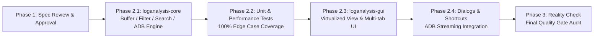

# LogAnalysis: Rust + GPUI Migration Technical Specification & Architecture Plan (v1.1.0 In-Depth Review)

- **Document Version:** 1.1.0 (Architecture, Edge Cases & Mathematical Modeling Deep Review)
- **Date:** 2026-11-03
- **Source Project:** [loganalysis_gui](file:///home/drew/github/hwanjongyu/loganalysis_gui) (Python / PyQt5)
- **Target Architecture:** Rust + GPUI (Zed Industries GPU-accelerated UI Framework)

---

## 1. Precise Analysis of Legacy Python/PyQt5 Implementation (`loganalysis_gui`)

### 1.1 System Architecture and Operating Mechanism
`loganalysis_gui` is a PyQt5-based desktop application modernizing the [TextAnalysisTool](https://textanalysistool.github.io/) workflow, designed for large log inspection and real-time Android ADB streaming.

```mermaid
flowchart TD
    User([User Input / Mouse / Shortcuts]) --> MainWindow[LogAnalysisMainWindow]
    MainWindow --> LogViewController[LogViewController<br/>Viewport / Zoom / Clipboard / Context Menu]
    MainWindow --> FilterManager[FilterManager<br/>Multi-tab / D&D Reorder / Atomic JSON Storage]
    MainWindow --> AdbController[AdbController<br/>Device Scan / Logcat / Pending Queue]
    MainWindow --> SearchController[SearchController<br/>Inline & Async Hybrid Search]
    
    LogViewController --> LogModel[LogModel: QAbstractListModel]
    LogModel --> FilterEngine[FilterEngine<br/>Rule Evaluation / Independent BG & FG Style Resolution]
    
    subgraph Background Workers (QThread)
        FileLoadWorker[FileLoadWorker<br/>Chunk Binary Load & Max Line Width Measurement]
        FilterWorker[FilterWorker<br/>Off-thread Filtering & Match Count Aggregation]
        AdbWorker[AdbWorker<br/>adb logcat Pipe 100-line Batch Streaming]
        AdbDeviceScanWorker[AdbDeviceScanWorker<br/>3s Timeout Device Discovery]
        SearchWorker[SearchWorker<br/>Non-blocking Cyclic Index Search]
    end
```

### 1.2 Core Components and Edge Case Specifications

| Component | Source Path | Core Operating Mechanism & Invariant Requirements |
| :--- | :--- | :--- |
| **LogModel** | [`models.py`](file:///home/drew/github/hwanjongyu/loganalysis_gui/src/loganalysis_gui/models.py) | - Separate storage for `all_lines` (raw) and `visible_indices` (visible row indices)<br/>- `_style_cache`: up to `10,000` items LRU cache, `_qcolor_cache`: up to `512` items cache<br/>- Line number format: `f"{real_idx + 1:6d} \| {clean_text}"`<br/>- Mouse hover tooltip: displays all matching filters (`[REGEX]`/`[TEXT]`, color options, strike-through `<strike>` for exclude filters) |
| **FilterEngine** | [`filter_engine.py`](file:///home/drew/github/hwanjongyu/loganalysis_gui/src/loganalysis_gui/filter_engine.py) | - `_REGEX_CACHE`: thread-safe cache for up to `1,024` compiled regexes<br/>- **Empty Filters Edge Case**: When 0 active filters are present, even if `show_only_filtered=True`, **display all lines** (`return [], True`)<br/>- **Unmatched Row Color**: When `show_only_filtered=False`, rows matching no filters are dimmed with foreground color `#808080` (gray)<br/>- **Independent BG/FG Reverse Inheritance**: When iterating matched filters in reverse (`reversed`), if the last matching filter has `exclude=True`, immediately return `(None, None)`. Otherwise, `bg_color` and `text_color` are independently adopted from the latest matching filter that defines non-`"None"` values. |
| **FilterManager** | [`filter_manager.py`](file:///home/drew/github/hwanjongyu/loganalysis_gui/src/loganalysis_gui/filter_manager.py) | - Multi-tab: per-tab enabled checkbox, double-click rename, unsaved change dirty indicator `*`, exit confirmation dialog (`Save / Discard / Cancel`)<br/>- In-tab search (`search_input`): instant filtering against `text`, `description`, badge text (`NOT:`, `REGEX:`, `CASE:`) without altering active log filter results<br/>- Drag-and-drop reordering (`InternalMove`) immediately resynchronizes filter evaluation priority<br/>- **Backward-Compatible Loading for 3 JSON Formats**: ① `{"name", "enabled", "filters"}` object, ② array of tab objects `[...]`, ③ plain array of filters `[...]`<br/>- Atomic write: write to `.tmp` temporary file followed by atomic `os.replace` |
| **AdbController & Workers** | [`adb_controller.py`](file:///home/drew/github/hwanjongyu/loganalysis_gui/src/loganalysis_gui/adb_controller.py)<br/>[`workers.py`](file:///home/drew/github/hwanjongyu/loganalysis_gui/src/loganalysis_gui/workers.py)<br/>[`constants.py`](file:///home/drew/github/hwanjongyu/loganalysis_gui/src/loganalysis_gui/constants.py) | - Serial number security validation: reject strings starting with `-` or containing characters outside `[a-zA-Z0-9.\-_:]` (flag injection defense)<br/>- **Rolling Buffer Hysteresis Trim**: `MAX_MONITOR_LINES = 200,000` lines; trim only when excess exceeds `MONITOR_TRIM_BATCH = 20,000` lines to prevent frequent reallocation<br/>- **Pending Chunks Queue**: When paused (`is_paused`) or refiltering (`is_refiltering`), buffer incoming chunks into `pending_chunks` and flush sequentially upon resumption<br/>- **Smart Auto-Scroll**: Maintain bottom scroll only if the scrollbar was at the bottom (`value == maximum`) immediately prior to chunk insertion |
| **SearchController & Dialogs** | [`search_controller.py`](file:///home/drew/github/hwanjongyu/loganalysis_gui/src/loganalysis_gui/search_controller.py)<br/>[`dialogs.py`](file:///home/drew/github/hwanjongyu/loganalysis_gui/src/loganalysis_gui/dialogs.py) | - **Hybrid Search Threshold**: If visible row count $\le 5,000$ (`ASYNC_SEARCH_THRESHOLD`), perform synchronous UI-thread cyclic search; if $> 5,000$, dispatch background worker search with progress updates every 10,000 rows<br/>- 250ms debounced real-time search term background highlighting (dark `#3E2723`, light `#FFF9C4` — takes precedence over filter background colors)<br/>- **WCAG 2.1 Contrast Verification**: Real-time relative luminance calculation in `FilterDialog`: display critical warning below $3.0:1$, warning below $4.5:1$ |

---

## 2. In-Depth Review of Spec v1.0.0 and Key Refinements

> [!IMPORTANT]
> Comparing the initial v1.0.0 draft against the Python source code and GPUI framework characteristics identified **7 critical technical gaps**, addressed in this v1.1.0 specification.

1. **Constant and Specification Consistency**:
   - Realigned real-time monitoring buffer bounds with production code ([`constants.py`](file:///home/drew/github/hwanjongyu/loganalysis_gui/src/loganalysis_gui/constants.py#L2-L3)) to `MAX_MONITOR_LINES = 200,000` and `MONITOR_TRIM_BATCH = 20,000`. The file size limit (legacy Python 500MB hard cap) is lifted under the Rust Mmap architecture while remaining configurable.
2. **Byte-Level Zero-Allocation Filtering & Hybrid Regex Engine**:
   - v1.0.0 assumed UTF-8 decoding and lowercasing (`line.to_lowercase()`) per line, incurring excessive heap allocations across millions of rows.
   - Using `regex::bytes::Regex` and `memchr::memmem`, matching is performed **directly on raw byte slices (`&[u8]`)**. A two-tier engine falls back to `fancy-regex` only when lookaround (`(?=...)`, `(?!...)`) or backreferences (`\1`) are detected.
3. **Viewport Anchor Preservation (`Nearest-Neighbor Scroll Sync`)**:
   - Added a binary search (`binary_search`) algorithm to track the user's previously selected raw row (`target_source_idx`) when toggling `Ctrl+H` (show filtered lines only $\leftrightarrow$ show all lines), centering the viewport on the nearest visible line.
4. **GPUI `uniform_list` Horizontal Scrolling and Row Selection State Machine**:
   - Unlike Qt `QTreeView`, GPUI `uniform_list` does not provide native multi-row selection (`ExtendedSelection`) or horizontal scroll synchronization.
   - Introduced a `SelectionModel` (single click, `Shift` range select, `Ctrl` toggle) and viewport horizontal geometry synchronization for full-line display.
5. **Mmap Safety (`SIGBUS` Defense) Strategy**:
   - Analyzed `SIGBUS` hazards from `memmap2` if an external process truncates an open file. Defined safety guards using chunk byte arenas (`Bytes`) or read-only duplicate mapping below configured thresholds.

---

## 3. Mathematical & Geometric Modeling and Algorithm Specifications

### 3.1 Viewport Anchor Preservation Model (Binary Search)
When filter conditions change and visible row indices $V = [v_0, v_1, \dots, v_{m-1}]$ ($v_0 < v_1 < \dots < v_{m-1}$) are recomputed, given the selected raw line index $t \in \mathbb{N}_0$ (`target_source_idx`) prior to change, the new selected row index $r^*$ is determined by:

$$p = \min \{ i \in \{0, \dots, m\} \mid i = m \text{ or } V[i] \ge t \} \quad (\text{i.e., } \texttt{bisect\_left}(V, t))$$

$$r^* = \begin{cases} 
\text{None} & \text{if } m = 0 \\
0 & \text{if } p = 0 \\
m - 1 & \text{if } p = m \\
p & \text{if } 0 < p < m \text{ and } (V[p] - t) \le (t - V[p-1]) \\
p - 1 & \text{if } 0 < p < m \text{ and } (V[p] - t) > (t - V[p-1])
\end{cases}$$

Based on $r^*$, `UniformListScrollHandle::scroll_to_item(r^*, ScrollStrategy::Center)` is invoked in GPUI to maintain the user's visual reference point.

---

### 3.2 WCAG 2.1 Relative Luminance & Contrast Model
To verify readability in the filter dialog and description text (`// desc`), normalized 8-bit RGB channels $C_8 \in [0, 255]$ with $C = C_8 / 255.0$ undergo linear sRGB transformation:

$$f_{\text{lin}}(C) = \begin{cases} \dfrac{C}{12.92} & \text{if } C \le 0.03928 \\[6pt] \left(\dfrac{C + 0.055}{1.055}\right)^{2.4} & \text{if } C > 0.03928 \end{cases}$$

Relative Luminance $L \in [0, 1]$ and Contrast Ratio $CR \in [1, 21]$ between two colors $(L_{\text{bg}}, L_{\text{fg}})$ are given by:

$$L = 0.2126 \, f_{\text{lin}}(R) + 0.7152 \, f_{\text{lin}}(G) + 0.0722 \, f_{\text{lin}}(B)$$

$$CR(L_{\text{bg}}, L_{\text{fg}}) = \frac{\max(L_{\text{bg}}, L_{\text{fg}}) + 0.05}{\min(L_{\text{bg}}, L_{\text{fg}}) + 0.05}$$

- **Threshold Classification**:
  - $CR < 3.0$: `Critical: Very poor contrast!` (critical badge)
  - $3.0 \le CR < 4.5$: `Warning: Low contrast.` (warning badge)
  - $CR \ge 4.5$: Normal (no warning)

---

### 3.3 Virtualized List Geometry & Horizontal Scrolling Model
Given monospaced font size $S_{\text{pt}} \in [6, 30]$, glyph advance width $w_{\text{char}}(S_{\text{pt}})$, and line height $h_{\text{row}}(S_{\text{pt}}) = \lceil 1.4 \times S_{\text{pt}} \rceil$ px:

1. **Line Number Gutter Width**:
   $$W_{\text{gutter}} = \begin{cases} \left(\max(6, \lfloor \log_{10}(\max(N_{\text{total}}, 1)) \rfloor + 1) + 3\right) \cdot w_{\text{char}}(S_{\text{pt}}) & \text{if } \texttt{show\_line\_numbers} \\ 0 & \text{otherwise} \end{cases}$$
2. **Total Line Rendering Width ($W_{\text{content}}$)**:
   - `Full Line Display = false` (Compact Mode): $W_{\text{content}} = W_{\text{viewport}}$, with right ellipsis (`text_ellipsis()`).
   - `Full Line Display = true`: For maximum character length across visible rows $L_{\max} = \max_{r \in V} \text{len}(\text{line}_r)$:
     $$W_{\text{content}} = \max\left(W_{\text{viewport}}, \, W_{\text{gutter}} + L_{\max} \cdot w_{\text{char}}(S_{\text{pt}}) + 24\text{px}\right)$$
   - Horizontal scroll offset $\Delta x \in [0, W_{\text{content}} - W_{\text{viewport}}]$ is synchronized to the text layer of each row container via `ml(-px(delta_x))`. The line number gutter ($W_{\text{gutter}}$) remains pinned on the left so line numbers stay visible during horizontal scrolling.

---

## 4. Module Architecture of New Project (`loganalysis`)

```
loganalysis/
├── Cargo.toml                        # Workspace root
├── docs/
│   └── spec-loganalysis-rust-gpui.md
├── crates/
│   ├── loganalysis-core/             # Headless core domain & high-performance engine crate
│   │   ├── Cargo.toml
│   │   └── src/
│   │       ├── lib.rs
│   │       ├── constants.rs          # COLOR_MAP, TEXT_COLOR_MAP, buffer constants
│   │       ├── buffer/               # Log storage layer
│   │       │   ├── mod.rs            # LogSource trait & LineSlice
│   │       │   ├── file_buffer.rs    # Mmap / chunk hybrid loader + memchr indexer
│   │       │   └── stream_buffer.rs  # 200K-line rolling ringbuffer (20K batch trim)
│   │       ├── filter/               # Filter engine & parallel evaluation
│   │       │   ├── mod.rs
│   │       │   ├── model.rs          # FilterRule, FilterTabData, 3-format JSON serde compatibility
│   │       │   ├── matcher.rs        # regex::bytes + fancy-regex + memmem matcher
│   │       │   ├── engine.rs         # Rayon parallel evaluation, reverse style resolution, anchor search
│   │       │   └── contrast.rs       # WCAG 2.1 relative luminance & contrast ratio calculator
│   │       ├── search/               # Search engine
│   │       │   └── searcher.rs       # Sync (<=5000 lines) / Async (>5000 lines) cyclic searcher
│   │       └── adb/                  # ADB subprocess management
│   │           ├── mod.rs
│   │           ├── device.rs         # adb devices async scanner (3s timeout, serial validation)
│   │           └── logcat.rs         # adb logcat 100-line / 16ms chunk streamer
│   │
│   └── loganalysis-gui/              # GPUI desktop frontend crate
│       ├── Cargo.toml
│       └── src/
│           ├── main.rs               # GPUI Application bootstrap & menu/action registration
│           ├── actions.rs            # Shortcuts & GPUI Action definitions
│           ├── theme.rs              # Dark / Light theme palettes (100% constants.py parity)
│           ├── workspace.rs          # Main window controller & async worker orchestration
│           ├── selection.rs          # Multi-line selection model (Single, Shift-Range, Ctrl-Toggle)
│           └── views/
│               ├── toolbar.rs        # Quick Filter, Mode Badges, ADB device selector / control
│               ├── log_list.rs       # uniform_list virtualized view + pinned gutter + tooltip
│               ├── filter_panel.rs   # Multi-tab, tab checkboxes, in-tab search, D&D filter list
│               ├── filter_modal.rs   # Add/Edit filter modal + real-time preview & contrast warning
│               ├── find_modal.rs     # Floating Find bar (250ms debounced highlight)
│               └── status_bar.rs     # Line statistics, filename badge, progress bar
```

---

## 5. Core Data Structures and Rust Interface Design

### 5.1 Two-Tier Hybrid Matcher (`loganalysis-core::filter::matcher`)
```rust
pub enum CompiledMatcher {
    /// Case-sensitive literal substring (SIMD search)
    LiteralCaseSensitive(memchr::memmem::Finder<'static>),
    /// Case-insensitive ASCII literal (zero-allocation byte comparison)
    LiteralAsciiInsensitive(Vec<u8>),
    /// Case-insensitive Unicode literal
    LiteralUnicodeInsensitive(String),
    /// Standard regex (guaranteed O(N) linear time, direct byte-slice matching)
    StandardRegex(regex::bytes::Regex),
    /// Advanced regex with lookaround or backreferences (Python re fallback)
    FancyRegex(fancy_regex::Regex),
}
```

### 5.2 Style Resolution and Empty Filter Handling (`loganalysis-core::filter::engine`)
```rust
#[derive(Clone, Copy, Debug, PartialEq, Eq, Default)]
pub struct ResolvedStyle {
    pub bg_hex: Option<u32>,
    pub fg_hex: Option<u32>,
}

/// Faithful recreation of legacy filter_engine.py evaluate_line + resolve_line_style
pub fn evaluate_and_style_line(
    raw_line: &[u8],
    prepared_filters: &[PreparedFilter],
    show_only_filtered: bool,
    filter_counts: &[AtomicUsize],
) -> (bool, ResolvedStyle) {
    // 1. When no active filters exist: show all lines regardless of show_only_filtered
    if prepared_filters.is_empty() {
        return (true, ResolvedStyle { bg_hex: None, fg_hex: Some(0x808080) });
    }

    let mut matched_indices = smallvec::SmallVec::<[usize; 8]>::new();
    for (idx, pf) in prepared_filters.iter().enumerate() {
        if pf.matches(raw_line) {
            filter_counts[pf.flat_index].fetch_add(1, Ordering::Relaxed);
            matched_indices.push(idx);
        }
    }

    // 2. When no filters match this line
    if matched_indices.is_empty() {
        let is_visible = !show_only_filtered;
        return (is_visible, ResolvedStyle { bg_hex: None, fg_hex: Some(0x808080) });
    }

    // 3. Check if the last matching filter is Exclude
    let last_filter = &prepared_filters[*matched_indices.last().unwrap()];
    if last_filter.rule.exclude {
        return (false, ResolvedStyle::default());
    }

    // 4. Reverse iterate to independently inherit BG and FG
    let mut bg_hex = None;
    let mut fg_hex = None;
    for &idx in matched_indices.iter().rev() {
        let rule = &prepared_filters[idx].rule;
        if rule.exclude {
            bg_hex = None;
            fg_hex = None;
            break;
        }
        if bg_hex.is_none() {
            bg_hex = rule.resolved_bg_hex;
        }
        if fg_hex.is_none() {
            fg_hex = rule.resolved_fg_hex;
        }
        if bg_hex.is_some() && fg_hex.is_some() {
            break;
        }
    }

    (true, ResolvedStyle { bg_hex, fg_hex })
}
```

### 5.3 Request ID-Based Async Cancellation (`RequestGuard`)
The legacy Python `filter_request_id`, `file_load_request_id`, `search_request_id`, and `scan_request_id` patterns are abstracted in Rust via `Arc<AtomicU64>` generation counters:
- Each new filter, search, or file load request increments the counter using `fetch_add(1)`.
- Running Rayon parallel tasks or file loaders verify the generation counter per chunk, terminating execution immediately (early abort) if a newer request has started to conserve CPU resources.

---

## 6. Phased Implementation and Verification Roadmap



1. **Phase 2.1 (`loganalysis-core` Implementation)**:
   - Implement `constants.rs`, `buffer`, `filter` (3-format JSON compatibility, hybrid regex, reverse style resolution, WCAG contrast), `search`, and `adb`.
2. **Phase 2.2 (`loganalysis-core` Deterministic Test Suite)**:
   - Port all test scenarios from Python `tests/` (empty filters, exclude priority, BG/FG independent inheritance, 200K rolling trim, serial security validation, binary search anchor preservation, 3 JSON formats) to Rust unit tests (`cargo test`).
3. **Phase 2.3 (`loganalysis-gui` Core Views)**:
   - Implement GPUI workspace, Quick Filter toolbar, mode badges (`Matches only` / `All lines`, `Full lines` / `Compact lines`), pinned line number gutter `uniform_list` log view, and multi-tab filter panel.
4. **Phase 2.4 (Dialogs & Real-time Streaming Integration)**:
   - Wire `FilterModal` (real-time WCAG contrast preview), `FindModal` (250ms debounced highlighting), context menus, and unsaved tab exit confirmation dialogs.
5. **Phase 3 (Final Quality Audit)**:
   - Full workspace build and test suite pass verification with zero functional regressions against the legacy reference.
