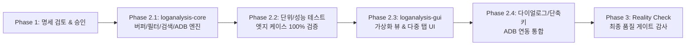

# LogAnalysis: Rust + GPUI 전환 기술 명세서 및 아키텍처 기획 (v1.1.0 심층 검토본)

- **문서 버전:** 1.1.0 (아키텍처/엣지 케이스/수학적 모델링 심층 보완)
- **작성일:** 2026-11-03
- **원작 프로젝트:** [loganalysis_gui](file:///home/drew/github/hwanjongyu/loganalysis_gui) (Python / PyQt5)
- **신규 타깃 아키텍처:** Rust + GPUI (Zed Industries GPU 가속 UI 프레임워크)

---

## 1. 기존 Python/PyQt5 구현체 (`loganalysis_gui`) 정밀 분석

### 1.1 시스템 구성 및 동작 메커니즘
`loganalysis_gui`는 [TextAnalysisTool](https://textanalysistool.github.io/)의 워크플로우를 현대화하여 대용량 로그 탐색 및 실시간 Android ADB 스트리밍을 지원하는 PyQt5 기반 데스크톱 도구입니다.

```mermaid
flowchart TD
    User([사용자 입력/마우스/단축키]) --> MainWindow[LogAnalysisMainWindow]
    MainWindow --> LogViewController[LogViewController<br/>뷰포트/줌/클립보드/컨텍스트메뉴]
    MainWindow --> FilterManager[FilterManager<br/>다중 탭/D&D 정렬/원자적 JSON 저장]
    MainWindow --> AdbController[AdbController<br/>디바이스 스캔/Logcat/Pending 큐]
    MainWindow --> SearchController[SearchController<br/>인라인·비동기 하이브리드 검색]
    
    LogViewController --> LogModel[LogModel: QAbstractListModel]
    LogModel --> FilterEngine[FilterEngine<br/>규칙 평가/독립 BG·FG 스타일 결정]
    
    subgraph Background Workers (QThread)
        FileLoadWorker[FileLoadWorker<br/>청크 바이너리 로드 & 최장 라인 계측]
        FilterWorker[FilterWorker<br/>오프스레드 필터링 & 필터별 매칭 집계]
        AdbWorker[AdbWorker<br/>adb logcat 파이프 100줄 배치 스트리밍]
        AdbDeviceScanWorker[AdbDeviceScanWorker<br/>3초 타임아웃 기기 탐색]
        SearchWorker[SearchWorker<br/>비차단 순환 인덱스 검색]
    end
```

### 1.2 핵심 컴포넌트별 기능 및 엣지 케이스 명세

| 컴포넌트 | 소스 위치 | 핵심 동작 메커니즘 및 필수 보존 사양 |
| :--- | :--- | :--- |
| **LogModel** | [`models.py`](file:///home/drew/github/hwanjongyu/loganalysis_gui/src/loganalysis_gui/models.py) | - `all_lines`(원본) 및 `visible_indices`(가시 행 인덱스) 분리 보관<br/>- `_style_cache`: 최대 `10,000`건 LRU 캐시, `_qcolor_cache`: 최대 `512`건 캐시<br/>- 행 번호 포맷: `f"{real_idx + 1:6d} \| {clean_text}"`<br/>- 마우스 오버 툴팁: 해당 행과 매칭된 모든 필터 목록(`[REGEX]`/`[TEXT]`, 색상 옵션, 제외 필터 `<strike>` 취소선) 표시 |
| **FilterEngine** | [`filter_engine.py`](file:///home/drew/github/hwanjongyu/loganalysis_gui/src/loganalysis_gui/filter_engine.py) | - `_REGEX_CACHE`: 최대 `1,024`개 컴파일된 정규식 스레드 안전 캐싱<br/>- **빈 필터 엣지 케이스**: 활성화된 필터가 0개일 때 `show_only_filtered=True`여도 **모든 행을 표시**(`return [], True`)<br/>- **비매칭 행 색상**: `show_only_filtered=False`일 때 어떤 필터에도 매칭되지 않은 행은 전경색 `#808080`(회색)으로 감쇠 처리<br/>- **독립적 BG/FG 역방향 상속**: 매칭된 필터들을 역순(`reversed`) 순회할 때, 마지막 매칭 필터가 `exclude=True`면 즉시 `(None, None)` 반환. 그렇지 않으면 `bg_color`와 `text_color`를 **각각 독립적으로** `"None"`이 아닌 가장 마지막 매칭 필터에서 채택 |
| **FilterManager** | [`filter_manager.py`](file:///home/drew/github/hwanjongyu/loganalysis_gui/src/loganalysis_gui/filter_manager.py) | - 다중 탭: 탭별 체크박스(활성/비활성), 더블클릭 이름 변경, 미저장 변경사항 `*` 표시 및 종료 시 저장 확인 팝업(`Save / Discard / Cancel`)<br/>- 탭 내부 검색(`search_input`): `text`, `description`, 배지 텍스트(`NOT:`, `REGEX:`, `CASE:`) 기준 즉시 필터링(실제 로그 필터링 결과에는 영향 없음)<br/>- 드래그 앤 드롭 순서 변경(`InternalMove`) 시 필터 우선순위 즉시 재동기화<br/>- **3가지 JSON 포맷 하위 호환 로드**: ① `{"name", "enabled", "filters"}` 객체, ② 탭 객체 배열 `[...]`, ③ 순수 필터 배열 `[...]`<br/>- 원자적 저장: `.tmp` 임시 파일 기록 후 `os.replace` 수행 |
| **AdbController & Workers** | [`adb_controller.py`](file:///home/drew/github/hwanjongyu/loganalysis_gui/src/loganalysis_gui/adb_controller.py)<br/>[`workers.py`](file:///home/drew/github/hwanjongyu/loganalysis_gui/src/loganalysis_gui/workers.py)<br/>[`constants.py`](file:///home/drew/github/hwanjongyu/loganalysis_gui/src/loganalysis_gui/constants.py) | - 시리얼 번호 보안 검증: `-`로 시작하거나 `[a-zA-Z0-9.\-_:]` 외 문자 포함 시 즉시 차단(인자 주입 방지)<br/>- **롤링 버퍼 히스테리시스 트림**: `MAX_MONITOR_LINES = 200,000`줄, 초과분이 `MONITOR_TRIM_BATCH = 20,000`줄 이상일 때만 슬라이싱하여 빈번한 재할당 방지<br/>- **Pending Chunks 큐**: 일시정지(`is_paused`) 중이거나 재필터링(`is_refiltering`) 진행 중일 때는 유입 청크를 `pending_chunks`에 적재하고 완료 후 순차 플러시<br/>- **스마트 자동 스크롤**: 청크 추가 직전 스크롤바가 최하단(`value == maximum`)에 있었을 때만 하단 스크롤 유지 |
| **SearchController & Dialogs** | [`search_controller.py`](file:///home/drew/github/hwanjongyu/loganalysis_gui/src/loganalysis_gui/search_controller.py)<br/>[`dialogs.py`](file:///home/drew/github/hwanjongyu/loganalysis_gui/src/loganalysis_gui/dialogs.py) | - **하이브리드 검색 임계값**: 가시 행 수 $\le 5,000$ (`ASYNC_SEARCH_THRESHOLD`)이면 UI 스레드 즉시 순환 검색, $> 5,000$이면 백그라운드 워커 검색 (10,000행마다 진행률 업데이트)<br/>- 250ms 디바운스 실시간 검색어 배경 하이라이팅 (다크 `#3E2723`, 라이트 `#FFF9C4` — 필터 배경색보다 우선 적용)<br/>- **WCAG 2.1 명암비 검증**: `FilterDialog`에서 실시간 상대 휘도 계산으로 $3.0:1$ 미만 위험, $4.5:1$ 미만 경고 표시 |

---

## 2. 기획서 v1.0.0 심층 검토 결과 및 보완 사항 요약

> [!IMPORTANT]
> 기존 v1.0.0 초안을 실제 소스 코드 및 GPUI 프레임워크 특성과 대조 검토한 결과, **7가지 핵심 기술적 갭(Gap)**을 식별하고 본 v1.1.0 명세에 반영했습니다.

1. **상수 및 사양 정합성 교정**:
   - 실시간 모니터링 버퍼 상한을 실제 코드([`constants.py`](file:///home/drew/github/hwanjongyu/loganalysis_gui/src/loganalysis_gui/constants.py#L2-L3))와 동일한 `MAX_MONITOR_LINES = 200,000`, `MONITOR_TRIM_BATCH = 20,000`으로 정정하고, 파일 크기 제한(기존 Python 500MB 하드 캡)을 Rust Mmap 아키텍처에서는 완화하되 설정 가능하도록 설계했습니다.
2. **바이트 레벨 Zero-Allocation 필터링 & 하이브리드 정규식 엔진**:
   - v1.0.0에서는 라인마다 UTF-8 디코딩 후 소문자 변환(`line.to_lowercase()`)을 가정했으나, 이는 수백만 줄 처리 시 불필요한 힙 할당을 유발합니다.
   - `regex::bytes::Regex` 및 `memchr::memmem`을 사용해 **원본 바이트 슬라이스(`&[u8]`) 상태에서 직접 매칭**하고, Python 정규식의 전방/후방 탐색(`(?=...)`, `(?!...)`)이나 역참조(`\1`)가 포함된 필터만 `fancy-regex`로 폴백(Fallback)하는 2단계 엔진을 도입합니다.
3. **재필터링 시 뷰포트 앵커 보존 (`Nearest-Neighbor Scroll Sync`) 수학적 모델 추가**:
   - `Ctrl+H`(매칭된 줄만 보기 $\leftrightarrow$ 전체 줄 보기) 전환 시 사용자가 보던 원본 행(`target_source_idx`)을 이진 탐색(`binary_search`)으로 추적하여 가장 가까운 가시 행으로 뷰포트 중앙 정렬하는 알고리즘을 명세화했습니다.
4. **GPUI `uniform_list` 수평 스크롤 및 행 선택(Selection) 상태 머신 설계**:
   - GPUI의 `uniform_list`는 Qt의 `QTreeView`와 달리 다중 행 선택(`ExtendedSelection`)이나 수평 스크롤 동기화를 기본 내장하지 않습니다.
   - 이를 해결하기 위한 `SelectionModel`(단일 클릭, `Shift` 범위 선택, `Ctrl` 개별 토글)과 `Full Line Display` 수평 스크롤 동기화 기하학 모델을 추가했습니다.
5. **Mmap 안전성(`SIGBUS` 방어) 전략 수립**:
   - 외부 프로세스에 의해 로그 파일이 잘릴(truncate) 경우 `memmap2`가 발생시킬 수 있는 `SIGBUS` 위험을 분석하고, 안전 임계값 이하 파일은 청크 바이트 아레나(`Bytes`)로 적재하거나 읽기 전용 복제 매핑을 사용하는 보호 계층을 정의했습니다.

---

## 3. 핵심 수학적·기하학적 모델링 및 알고리즘 명세

### 3.1 뷰포트 앵커 보존 이진 탐색 모델 (Viewport Anchor Preservation)
필터 조건이 변경되어 가시 행 인덱스 배열 $V = [v_0, v_1, \dots, v_{m-1}]$ ($v_0 < v_1 < \dots < v_{m-1}$)이 재계산될 때, 변경 직전 선택된 원본 행 번호를 $t \in \mathbb{N}_0$ (`target_source_idx`)라 하면, 새로운 선택 행 인덱스 $r^*$는 다음과 같이 결정됩니다:

$$p = \min \{ i \in \{0, \dots, m\} \mid i = m \text{ or } V[i] \ge t \} \quad (\text{즉, } \texttt{bisect\_left}(V, t))$$

$$r^* = \begin{cases} 
\text{None} & \text{if } m = 0 \\
0 & \text{if } p = 0 \\
m - 1 & \text{if } p = m \\
p & \text{if } 0 < p < m \text{ and } (V[p] - t) \le (t - V[p-1]) \\
p - 1 & \text{if } 0 < p < m \text{ and } (V[p] - t) > (t - V[p-1])
\end{cases}$$

결정된 $r^*$를 기준으로 GPUI `UniformListScrollHandle::scroll_to_item(r^*, ScrollStrategy::Center)`를 호출하여 사용자의 시선 위치를 보존합니다.

---

### 3.2 WCAG 2.1 상대 휘도 및 명암비 모델 (Contrast Verification)
필터 대화상자 및 필터 아이템 설명(`// desc`)의 가독성 검증을 위해 8비트 RGB 채널 $C_8 \in [0, 255]$를 정규화한 $C = C_8 / 255.0$에 대해 선형 sRGB 변환을 수행합니다:

$$f_{\text{lin}}(C) = \begin{cases} \dfrac{C}{12.92} & \text{if } C \le 0.03928 \\[6pt] \left(\dfrac{C + 0.055}{1.055}\right)^{2.4} & \text{if } C > 0.03928 \end{cases}$$

상대 휘도(Relative Luminance) $L \in [0, 1]$ 및 두 색상 $(L_{\text{bg}}, L_{\text{fg}})$ 간의 명암비 $CR \in [1, 21]$은 다음과 같습니다:

$$L = 0.2126 \, f_{\text{lin}}(R) + 0.7152 \, f_{\text{lin}}(G) + 0.0722 \, f_{\text{lin}}(B)$$

$$CR(L_{\text{bg}}, L_{\text{fg}}) = \frac{\max(L_{\text{bg}}, L_{\text{fg}}) + 0.05}{\min(L_{\text{bg}}, L_{\text{fg}}) + 0.05}$$

- **판정 임계값**:
  - $CR < 3.0$: `Critical: Very poor contrast!` (경고 배지 출력)
  - $3.0 \le CR < 4.5$: `Warning: Low contrast.` (주의 배지 출력)
  - $CR \ge 4.5$: 정상 (무표시)

---

### 3.3 가상화 리스트 기하학 및 수평 스크롤 모델 (Viewport Geometry)
고정폭 폰트 크기 $S_{\text{pt}} \in [6, 30]$에서 글리프 advance 폭을 $w_{\text{char}}(S_{\text{pt}})$, 행 높이를 $h_{\text{row}}(S_{\text{pt}}) = \lceil 1.4 \times S_{\text{pt}} \rceil$ px라 할 때:

1. **행 번호 거터(Gutter) 폭**:
   $$W_{\text{gutter}} = \begin{cases} \left(\max(6, \lfloor \log_{10}(\max(N_{\text{total}}, 1)) \rfloor + 1) + 3\right) \cdot w_{\text{char}}(S_{\text{pt}}) & \text{if } \texttt{show\_line\_numbers} \\ 0 & \text{otherwise} \end{cases}$$
2. **행 전체 렌더링 폭 ($W_{\text{content}}$)**:
   - `Full Line Display = false` (Compact Mode): $W_{\text{content}} = W_{\text{viewport}}$, 우측 말줄임(`text_ellipsis()`) 적용.
   - `Full Line Display = true`: 가시 행 중 최대 문자 길이 $L_{\max} = \max_{r \in V} \text{len}(\text{line}_r)$에 대해:
     $$W_{\text{content}} = \max\left(W_{\text{viewport}}, \, W_{\text{gutter}} + L_{\max} \cdot w_{\text{char}}(S_{\text{pt}}) + 24\text{px}\right)$$
   - 수평 스크롤 오프셋 $\Delta x \in [0, W_{\text{content}} - W_{\text{viewport}}]$를 `uniform_list` 내부 행 컨테이너의 텍스트 레이어에 `ml(-px(delta_x))`로 동기화하고, 행 번호 거터($W_{\text{gutter}}$)는 좌측에 고정(Pinned Column)하여 긴 줄을 우측으로 스크롤해도 줄 번호가 항상 보이도록 개선합니다.

---

## 4. 신규 프로젝트 모듈 아키텍처 (`loganalysis`)

```
loganalysis/
├── Cargo.toml                        # Workspace 루트
├── docs/
│   └── spec-loganalysis-rust-gpui.md
├── crates/
│   ├── loganalysis-core/             # UI 무관 순수 도메인 & 고성능 엔진 크레이트
│   │   ├── Cargo.toml
│   │   └── src/
│   │       ├── lib.rs
│   │       ├── constants.rs          # COLOR_MAP, TEXT_COLOR_MAP, 버퍼 상수
│   │       ├── buffer/               # 로그 스토리지 계층
│   │       │   ├── mod.rs            # LogSource 트레이트 & LineSlice
│   │       │   ├── file_buffer.rs    # Mmap / 청크 하이브리드 로더 + memchr 인덱서
│   │       │   └── stream_buffer.rs  # 20만 줄 롤링 링버퍼 (2만 줄 배치 트림)
│   │       ├── filter/               # 필터 엔진 & 병렬 평가
│   │       │   ├── mod.rs
│   │       │   ├── model.rs          # FilterRule, FilterTabData, 3종 JSON Serde 호환
│   │       │   ├── matcher.rs        # regex::bytes + fancy-regex + memmem 매처
│   │       │   ├── engine.rs         # Rayon 병렬 평가, 역방향 스타일 결정, 앵커 탐색
│   │       │   └── contrast.rs       # WCAG 2.1 상대 휘도 & 명암비 계산기
│   │       ├── search/               # 검색 엔진
│   │       │   └── searcher.rs       # 동기(<=5000줄) / 비동기(>5000줄) 순환 탐색기
│   │       └── adb/                  # ADB 서브프로세스 관리
│   │           ├── mod.rs
│   │           ├── device.rs         # adb devices 비동기 스캐너 (3초 타임아웃, 시리얼 검증)
│   │           └── logcat.rs         # adb logcat 100줄/16ms 청크 스트리머
│   │
│   └── loganalysis-gui/              # GPUI 데스크톱 프론트엔드 크레이트
│       ├── Cargo.toml
│       └── src/
│           ├── main.rs               # GPUI Application 부트스트랩 & 메뉴/액션 등록
│           ├── actions.rs            # 단축키 & GPUI Action 정의
│           ├── theme.rs              # Dark / Light 테마 팔레트 (constants.py 100% 대응)
│           ├── workspace.rs          # 메인 윈도우 컨트롤러 & 비동기 워커 오케스트레이션
│           ├── selection.rs          # 다중 행 선택 모델 (Single, Shift-Range, Ctrl-Toggle)
│           └── views/
│               ├── toolbar.rs        # Quick Filter, Mode Badges, ADB 기기 선택/제어
│               ├── log_list.rs       # uniform_list 가상화 뷰 + 고정 줄번호 거터 + 툴팁
│               ├── filter_panel.rs   # 다중 탭, 탭 체크박스, 탭 내 검색, D&D 필터 리스트
│               ├── filter_modal.rs   # Add/Edit 필터 모달 + 실시간 프리뷰 & 명암비 경고
│               ├── find_modal.rs     # Find 플로팅 바 (250ms 디바운스 하이라이트)
│               └── status_bar.rs     # 라인 통계, 파일명 배지, 진행률 바
```

---

## 5. 핵심 데이터 구조 및 Rust 인터페이스 설계

### 5.1 2단계 하이브리드 매처 (`loganalysis-core::filter::matcher`)
```rust
pub enum CompiledMatcher {
    /// 대소문자 구분 일반 문자열 (SIMD 부분 문자열 검색)
    LiteralCaseSensitive(memchr::memmem::Finder<'static>),
    /// 대소문자 무시 ASCII 문자열 (할당 없는 바이트 비교)
    LiteralAsciiInsensitive(Vec<u8>),
    /// 대소문자 무시 유니코드 문자열
    LiteralUnicodeInsensitive(String),
    /// 표준 정규식 (선형 시간 O(N) 보장, 바이트 슬라이스 직접 매칭)
    StandardRegex(regex::bytes::Regex),
    /// 전방/후방 탐색 또는 역참조 포함 고급 정규식 (Python re 호환 폴백)
    FancyRegex(fancy_regex::Regex),
}
```

### 5.2 스타일 결정 및 빈 필터 처리 (`loganalysis-core::filter::engine`)
```rust
#[derive(Clone, Copy, Debug, PartialEq, Eq, Default)]
pub struct ResolvedStyle {
    pub bg_hex: Option<u32>,
    pub fg_hex: Option<u32>,
}

/// 기존 filter_engine.py의 evaluate_line + resolve_line_style 완벽 재현
pub fn evaluate_and_style_line(
    raw_line: &[u8],
    prepared_filters: &[PreparedFilter],
    show_only_filtered: bool,
    filter_counts: &[AtomicUsize],
) -> (bool, ResolvedStyle) {
    // 1. 활성 필터가 전혀 없을 때: show_only_filtered 값과 무관하게 전체 표시
    if prepared_filters.is_empty() {
        return (true, ResolvedStyle { bg_hex: None, fg_hex: Some(0x808080) });
    }

    let mut matched_indices = smallvec::SmallVec::<[usize; 8]>::new();
    for (idx, pf) in prepared_filters.iter().enumerate() {
        if pf.matches(raw_line) {
            filter_counts[pf.flat_index].fetch_add(1, Ordering::Relaxed);
            matched_indices.push(idx);
        }
    }

    // 2. 매칭된 필터가 없을 때
    if matched_indices.is_empty() {
        let is_visible = !show_only_filtered;
        return (is_visible, ResolvedStyle { bg_hex: None, fg_hex: Some(0x808080) });
    }

    // 3. 마지막 매칭 필터가 Exclude인지 확인
    let last_filter = &prepared_filters[*matched_indices.last().unwrap()];
    if last_filter.rule.exclude {
        return (false, ResolvedStyle::default());
    }

    // 4. 역순 순회하며 BG와 FG를 독립적으로 상속
    let mut bg_hex = None;
    let mut fg_hex = None;
    for &idx in matched_indices.iter().rev() {
        let rule = &prepared_filters[idx].rule;
        if rule.exclude {
            bg_hex = None;
            fg_hex = None;
            break;
        }
        if bg_hex.is_none() {
            bg_hex = rule.resolved_bg_hex;
        }
        if fg_hex.is_none() {
            fg_hex = rule.resolved_fg_hex;
        }
        if bg_hex.is_some() && fg_hex.is_some() {
            break;
        }
    }

    (true, ResolvedStyle { bg_hex, fg_hex })
}
```

### 5.3 요청 ID 기반 비동기 취소 토큰 (`RequestGuard`)
Python 원본의 `filter_request_id`, `file_load_request_id`, `search_request_id`, `scan_request_id` 패턴을 Rust에서는 `Arc<AtomicU64>` 세대 카운터(Generation Counter)로 추상화합니다:
- 새로운 필터/검색/파일 로드 요청이 발생하면 카운터를 `fetch_add(1)` 증가시킵니다.
- 실행 중인 Rayon 병렬 루프나 파일 로더는 청크마다 현재 세대 번호를 확인하여, 새로운 요청이 시작되었으면 즉시 연산을 중단(Early Abort)하여 CPU 낭비를 방지합니다.

---

## 6. 단계별 구현 및 검증 로드맵



1. **Phase 2.1 (`loganalysis-core` 구현)**:
   - `constants.rs`, `buffer`, `filter` (3종 JSON 호환, 하이브리드 정규식, 역방향 스타일 결정, WCAG 명암비), `search`, `adb` 구현.
2. **Phase 2.2 (`loganalysis-core` 결정론적 테스트 검증)**:
   - 기존 Python `tests/` 스위트의 모든 검증 시나리오(빈 필터, Exclude 우선순위, BG/FG 독립 상속, 20만 줄 롤링 트림, 시리얼 보안 검증, 이진 탐색 앵커 보존, 3종 JSON 로드)를 Rust 단위 테스트(`cargo test`)로 1:1 이식 및 검증.
3. **Phase 2.3 (`loganalysis-gui` 코어 뷰 구현)**:
   - GPUI 워크스페이스, 상단 Quick Filter 툴바, 모드 배지(`Matches only`/`All lines`, `Full lines`/`Compact lines`), 고정 줄번호 거터를 갖춘 `uniform_list` 로그 뷰, 다중 탭 필터 패널 구현.
4. **Phase 2.4 (다이얼로그 및 실시간 스트리밍 통합)**:
   - `FilterModal`(WCAG 실시간 명암비 프리뷰), `FindModal`(250ms 디바운스 하이라이팅), 우클릭 컨텍스트 메뉴, 미저장 탭 종료 경고창 연결.
5. **Phase 3 (최종 품질 감사)**:
   - 전체 빌드 및 테스트 통과 확인, 원본 기능 대비 누락 제로(Zero-Gap) 감사 수행.
