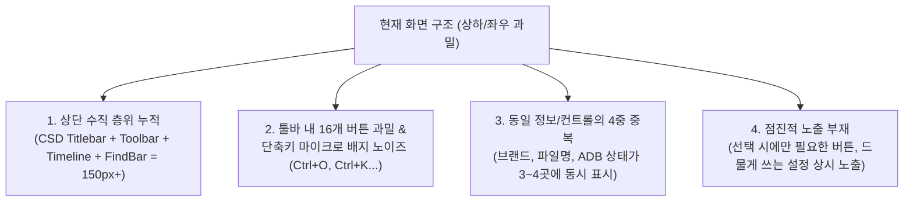

# LogAnalysis UI 단순화 및 시각적 정돈 계획 (UI Declutter & Simplification Spec)

## 1. 개요 및 목적
현재 LogAnalysis는 고성능 ADB 스트리밍, 정규식 하이라이트 필터, EPS 타임라인, 분할 뷰, 컬럼 뷰 등 강력한 분석 기능을 두루 갖추고 있습니다.  
그러나 모든 기능 버튼과 상태 배지가 화면 상단과 좌우에 상시 노출되어 **"화면이 정신없고 복잡해 보인다"**는 문제가 발생하고 있습니다.

본 계획은 **기존의 모든 기능을 100% 보존하면서, 화면의 시각적 잡음(Visual Clutter)을 60% 이상 걷어내고 직관적인 집중 환경(Clean & Focused Workspace)을 구축**하는 구체적인 UI/UX 개편안을 정의합니다.

---

## 2. 현재 화면의 4대 혼잡 원인 분석 (Root Cause Analysis)



1. **상단 수직 층위 누적 (Vertical Bar Overload)**:
   - CSD Titlebar (34px) + Toolbar (44px) + Timeline Ribbon (40px) = 로그 데이터를 보기도 전에 상단에만 3단 바가 중첩.
2. **툴바 내 16개 버튼 과밀 & 단축키 배지 노이즈**:
   - `Open`, `Load Profile`, `Save Profile`, `Clear`, `All Lines`, `Filtered Only`, `↔ H-Scroll`, `⬇ Tail`, `◨ Left/Bottom`, `Copy`, `+ Filter Sel`, `🔍 Find`, `☀ Light/Dark`, `⏸ Pause`, `📱 Device`, `⚡ Live ADB`
   - 버튼마다 회색 monospace 단축키 배지가 붙어 시각적 산만함 극대화.
3. **컨트롤 및 정보의 4중 중복 (Duplication)**:
   - 로고/브랜드: Titlebar + Toolbar에 중복.
   - 파일명 및 라인수: Titlebar + Toolbar Contextual Pill + Status Bar 3곳에 중복.
   - ADB 디바이스 및 스트림 상태: Titlebar + Toolbar + Activity Bar + Status Bar 4곳에 중복.
   - 테마 및 도크 위치 토글: Toolbar와 Activity Bar에 중복.
4. **점진적 노출(Progressive Disclosure)의 부재**:
   - 로그 라인을 선택했을 때만 의미 있는 `Copy`, `+ Filter Sel` 버튼이 툴바에 상시 자리 차지.
   - 필터 프로필 저장/불러오기, 도크 위치 변경 등 빈도가 낮은 액션이 최상위 1순위 영역에 배치.

---

## 3. UI 단순화 핵심 5대 전략 (Simplification Strategy)

### 전략 1: [통합 헤더 바 (Unified Header Bar)]
- 별도의 CSD Titlebar(34px)와 Toolbar(44px)를 하나의 **38px 단일 통합 헤더**로 결합 (Zed / VS Code / 현대적 데스크톱 앱 표준).
- **좌측**: 앱 아이콘 + `Open` 버튼 + `⚡ Live ADB` (상태에 따라 유동적).
- **중앙**: 간결한 활성 파일/기기 Pill (`📄 crash.log • 12.3k lines` 또는 `📱 Pixel 8 • Live`).
- **우측**: 뷰 모드 토글(`All` / `Filtered`), `🔍 Find`, `⋯` 오버플로우 더보기 메뉴, 윈도우 제어 버튼.
- 💡 **효과**: 상단 공간 40px 절약, 헤더가 정갈하고 세련되게 정리됨.

### 전략 2: [단축키 배지 제거 → 툴팁 및 커맨드 팔레트(`Ctrl+P`) 이관]
- 버튼 본문에 덕지덕지 붙어 있던 회색 단축키 배지(`Ctrl+O`, `Ctrl+K`, `Ctrl+H`, `Ctrl+C`, `Ctrl+F` 등) 완전 제거.
- 단축키 안내는 마우스 오버 시 나타나는 **고해상도 툴팁**과 **커맨드 팔레트(`Ctrl+P`)**를 통해 세련되게 제공.
- 💡 **효과**: 버튼 너비 감소, 텍스트 가독성 대폭 향상, 시각적 피로도 감소.

### 전략 3: [상황별 점진적 노출 (Contextual Actions)]
- **선택 액션 (`Copy`, `+Filter Sel`)**:
  - 로그 행을 마우스로 클릭/드래그하여 선택했을 때만 나타나는 **로그 뷰 우측 상단 플로팅 미니 액션 바** 또는 **우클릭 컨텍스트 메뉴**로 전환.
  - 선택하지 않았을 때는 보이지 않아 툴바를 깨끗하게 유지.
- **ADB 스트리밍 컨트롤**:
  - 비스트리밍 상태: 단순한 `⚡ Live ADB` 및 기기 선택 드롭다운만 표시.
  - 스트리밍 동작 중: `⏸ Pause` 버튼 및 실시간 상태 펄스 점등.
- **타임라인 스파크라인**:
  - 상시 표시 대신 기본적으로 숨김 처리하거나, 클릭/단축키(`Ctrl+Shift+T`)로 언제든 1초 만에 슬라이드 인/아웃.

### 전략 4: [거대 Filter Dock vs 1줄 Quick Filter Bar 역할 분담]
- 일반적인 로그 분석의 80%는 "빠른 키워드 검색" 및 "로그 레벨(V/D/I/W/E) 필터링"입니다.
- **1줄 Quick Filter Bar (로그 뷰 상단)**:
  - `[ 🔍 빠른 필터 입력 (Enter) ]` + `[V] [D] [I] [W] [E] 로그레벨 토글`
  - 복잡한 도크를 열지 않고도 즉시 필터링 가능.
- **전문가용 Filter Dock (`Ctrl+J`)**:
  - 여러 개의 탭 구성, 고급 정규식, 색상 커스텀, 통계 태그 분석 시에만 단축키나 액티비티 바 버튼으로 도크를 열어서 사용.

### 전략 5: [집중 모드 (Zen / Focus Mode - `F11`)]
- 로그 분석에만 몰입하고 싶을 때 단축키(`F11` 또는 `Ctrl+Shift+Z`)로 좌측 Activity Bar, Filter Dock, Timeline, Status Bar를 한 번에 숨기고 순수한 로그 텍스트만 넓게 보는 모드 제공.

---

## 4. 기능 보존 1:1 매핑 테이블 (100% Feature Parity Guarantee)

| 기존 기능 | 기존 위치 | 변경 후 신규 위치 | 기능 변화 여부 |
| :--- | :--- | :--- | :--- |
| **파일 열기 (Open)** | 툴바 좌측 (Ctrl+O 배지) | 통합 헤더 좌측 간결한 아이콘/버튼 | **100% 유지** (툴팁으로 단축키 안내) |
| **필터 프로필 로드/저장** | 툴바 좌측 2개 버튼 상시 노출 | 통합 헤더 우측 `⋯` (더보기) 메뉴 내부 | **100% 유지** (Ctrl+S, Ctrl+Shift+O 단축키 유지) |
| **로그 지우기 (Clear)** | 툴바 좌측 (Ctrl+K 배지) | 통합 헤더 `⋯` 메뉴 또는 로그 뷰 우측 미니 버튼 | **100% 유지** (Ctrl+K 단축키 유지) |
| **All / Filtered 전환** | 툴바 중앙 세그먼트 컨트롤 | 통합 헤더 우측 컴팩트 세그먼트 아이콘 버튼 | **100% 유지** (Ctrl+H 단축키 유지) |
| **가로 스크롤 / 클립** | 툴바 중앙 버튼 | 통합 헤더 `⋯` 메뉴 또는 상태바 미니 아이콘 | **100% 유지** (Alt+Z 유지) |
| **Tail (Auto-Scroll)** | 툴바 중앙 버튼 | 로그 뷰 우측 하단 플로팅 '⬇ Tail' 버튼 또는 헤더 | **100% 유지** (End 키 유지) |
| **도크 위치 (Left/Bottom)**| 툴바 중앙 버튼 | Filter Dock 헤더 내부 우측 아이콘 버튼 | **100% 유지** (Ctrl+Shift+L 유지) |
| **선택 줄 복사 / 필터 추가**| 툴바 중앙 2개 버튼 상시 노출 | **로그 선택 시 나타나는 플로팅 툴바 & 우클릭 메뉴** | **100% 유지** (더 직관적으로 개선) |
| **텍스트 검색 (Find)** | 툴바 우측 버튼 | 통합 헤더 우측 🔍 버튼 | **100% 유지** (Ctrl+F 유지) |
| **테마 전환 (Light/Dark)** | 툴바 우측 버튼 | 통합 헤더 `⋯` 메뉴 & 좌측 Activity Bar 톱니바퀴 | **100% 유지** (Ctrl+U 유지) |
| **ADB 기기 선택 / 시작** | 툴바 우측 3개 버튼/드롭다운 | 통합 헤더의 스마트 ADB 콤보 버튼 | **100% 유지** (Ctrl+R 유지) |
| **타임라인 스파크라인** | 상단 상시 노출 리본 | 필요 시 토글되는 슬라이드 패널 | **100% 유지** (Ctrl+Shift+T 유지) |
| **북마크 / 분할 뷰 / 패싯**| Activity Bar | Activity Bar 기존 위치 유지 | **100% 유지** |
| **커맨드 팔레트** | 단축키 / Activity Bar | `Ctrl+P` 및 헤더 클릭 | **100% 유지** |

---

## 5. UI 시각적 전/후 비교 (Conceptual Layout Comparison)

### [기존 복잡한 레이아웃]
```
┌────────────────────────────────────────────────────────────────────────┐
│ [Logo] LogAnalysis STUDIO   📄 file.log (CSD Titlebar)          _ □ ✕  │ (34px)
├────────────────────────────────────────────────────────────────────────┤
│ [Open Ctrl+O][Load][Save][Clear Ctrl+K] [All][Filtered Ctrl+H]         │
│ [H-Scroll][Tail][Dock] [Copy Ctrl+C][+Filter] [Find Ctrl+F][Theme][ADB]│ (44px)
├────────────────────────────────────────────────────────────────────────┤
│ 📈 [=========== Anomaly Timeline Sparkline Ribbon ===================] │ (40px)
├────┬───────────────────────┬───────────────────────────────────────────┤
│ 📁 │ [Filter Dock]         │ [Main Log Viewport]                       │
│ 🔍 │ Tab 1 | Tab 2         │ Line 1: ...                               │
│ 🏷️ │ Rule 1 [Fatal]        │ Line 2: ...                               │
│ 🔖 │ Rule 2 [Exception]    │ Line 3: ...                               │
│ 📈 │ + Add Rule [Color]    │ Line 4: ...                               │
├────┴───────────────────────┴───────────────────────────────────────────┤
│ ● Ready | 12,345 lines | 42 matches | 12.4 MB | UTF-8 | 60 FPS       │ (28px)
└────────────────────────────────────────────────────────────────────────┘
```

### [개선 후 심플 & 모던 레이아웃]
```
┌────────────────────────────────────────────────────────────────────────┐
│ [Logo] LogAnalysis  │  📄 file.log (12.3k lines)  │  [All|Filtered] 🔍 ⋯ _ □ ✕ │ (38px Unified)
├────┬───────────────────────────────────────────────────────────────────┤
│ 📁 │ [Main Log Viewport]                                               │
│ 🔍 │ Line 1: 11-07 15:10:02.123  1024  2048 I SystemServer: Init...    │
│ 🏷️ │ Line 2: 11-07 15:10:02.456  1024  2048 W ActivityManager: Slow.. │
│ 🔖 │ Line 3: 11-07 15:10:02.789  1024  2048 E AndroidRuntime: FATAL... │
│ 📱 │ (로그 선택 시 마우스 옆에 플로팅 [Copy][+Filter] 미니 버튼 등장) │
│    │                                                                   │
│ ⚙️ │                                                  [⬇ Tail Locked]  │
├────┴───────────────────────────────────────────────────────────────────┤
│ ● 12,345 lines  │  42 matches  │  12.4 MB                              │ (24px Slim)
└────────────────────────────────────────────────────────────────────────┘
```

---

## 6. 단계별 적용 로드맵

1. **Step 1: 툴바 버튼 텍스트 배지(Kbd Badges) 제거 및 툴팁 일원화** (가장 빠른 시각 노이즈 제거)
2. **Step 2: 선택 기반 액션(Copy, +Filter Sel) 및 부가 설정(Load/Save/Theme/H-Scroll)을 컨텍스트/더보기 메뉴로 이동**
3. **Step 3: Titlebar와 Toolbar를 단일 38px 'Unified Header'로 통합**
4. **Step 4: 타임라인 스파크라인 기본 접힘(Collapsible) 및 Focus Mode(F11) 단축키 연결**
5. **Step 5: 정밀 검증 (모든 기존 기능 동작, GPUI 컴파일, 렌더링 성능 60 FPS 유지)**
