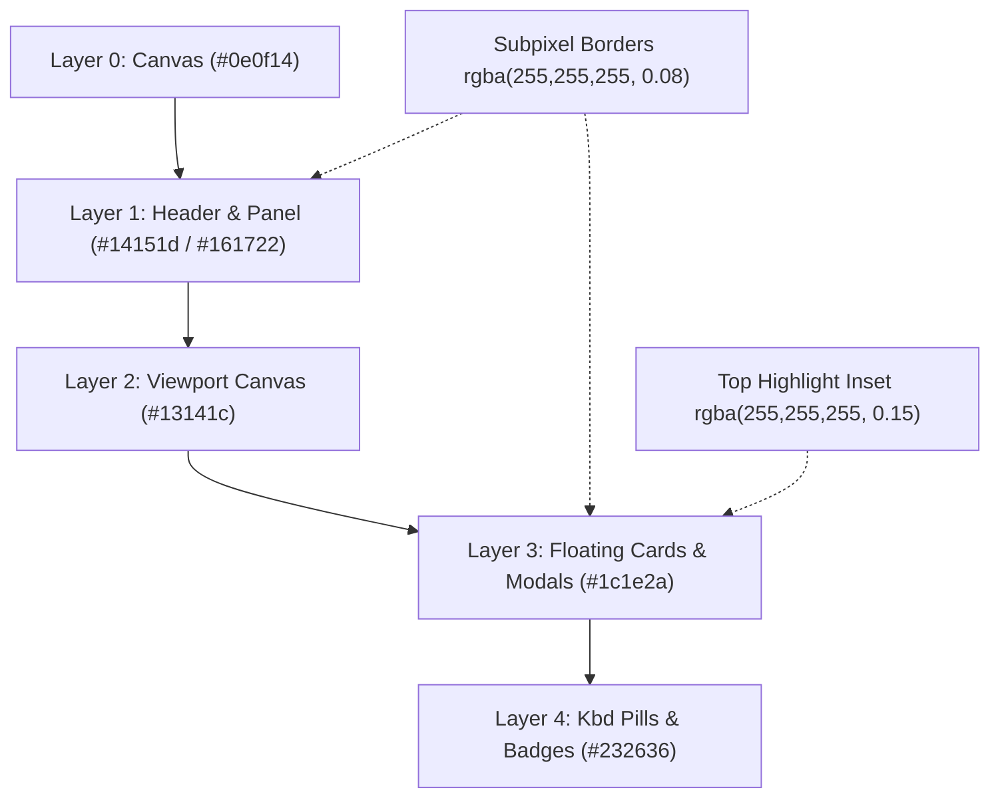

# 💎 Technical Specification: Professional UI Polish - Phase 1 (Typography, Elevation & Tooltips)

**Document ID:** `spec-ui-professional-phase1`  
**Target:** `crates/loganalysis-gui` & `crates/loganalysis-core`  
**Phase:** Phase 1: Architecture & Visual Polish Specification  
**Status:** APPROVED_FOR_GOAL_EXECUTION  

---

## 1. Executive Summary & Goals

This specification details Phase 1 of the **LogAnalysis Professional UI Evolution**, transitioning LogAnalysis from a raw utility desktop app into a **Zed / Linear / JetBrains Fleet-grade developer workstation**.

### Core Deliverables for Phase 1:
1. **Typography & Metadata Hierarchy**:
   - Monospace line gutter with tabular figures (`tnum`), right-aligned line numbers, and clean visual bookmarks indicator.
   - Distinct multiline stack trace indentation (`    at ...` / `Caused by:`) with accent edge markers.
   - Structured column grid refinements (precise column dividers, dimmed time/PID/TID, high-contrast tag pills, and micro-badges).
2. **Sub-Pixel Translucent Borders & 4-Tier Elevation**:
   - Modernized border alpha blending (`rgba(255, 255, 255, 0.08)` dark / `rgba(0, 0, 0, 0.08)` light).
   - Glassy top-edge inset highlight borders (`border_t_color(rgba(0xffffff26))`) on modals and floating cards (`command_palette`, `filter_edit_modal`, `note_edit_modal`, `bookmark_drawer`).
   - Refined button hover states and focus ring glow tokens.
3. **Tooltip System with Keyboard Shortcut Pills**:
   - Reusable GPUI `Tooltip` component displaying action descriptions alongside keyboard shortcut badges.
   - Comprehensive tooltip coverage across all primary toolbar controls, filter dock actions, and viewport toggles.

---

## 2. Architecture & Design Tokens

### 2.1 Surface & Border Tokens (`crates/loganalysis-gui/src/theme.rs`)



* **Translucent Structural Borders**:
  - Dark Theme: `border = rgba(0xffffff18)` (10% white), `border_subtle = rgba(0xffffff0d)` (5% white).
  - Light Theme: `border = rgba(0x00000014)` (8% black), `border_subtle = rgba(0x0000000a)` (4% black).
* **Modal Glass Inset**:
  - Floating dialogs and drawers feature `.border_t_1().border_t_color(rgba(0xffffff24))` on dark theme to simulate physical top-edge ambient light reflection.

---

## 3. Component Level Specifications

### 3.1 Tooltip Component (`crates/loganalysis-gui/src/components/tooltip.rs`)

A lightweight GPUI view conforming to `Render`:
```rust
pub struct SimpleTooltip {
    pub text: SharedString,
    pub shortcut: Option<&'static str>,
    pub theme: Theme,
}
```
Exposing helper:
```rust
pub fn render_tooltip(
    text: impl Into<SharedString>,
    shortcut: Option<&'static str>,
    theme: Theme,
) -> impl Fn(&mut Window, &mut App) -> AnyView + 'static
```
Visual styling:
- Dark background (`theme.bg_card`), sub-pixel border, subtle `shadow_lg()`, font size 11px.
- Integrated keyboard shortcut badge rendered in monospace font.

### 3.2 Log Gutter & Row Hierarchy (`crates/loganalysis-gui/src/components/log_view.rs`)

* **Gutter (`gutter_el`)**:
  - Right-aligned tabular digits with fixed width (64px) and right padding (`pr(px(8.0))`).
  - Subtle bookmark indicator icon (`🔖`) positioned on the left edge with zero line jitter.
  - Active line indicator with 2px accent border (`border_l_2`).
* **Stack Trace Visual Indentation**:
  - When lines match Java/Kotlin/Android stack trace signatures (`^\s*at\s+` or `^\s*Caused by:`), apply 16px left indentation with a dimmed left border indicator (`border_l_2().border_color(theme.border_subtle)`).
* **Column Grid Mode**:
  - Ensure column dividers use translucent `border_subtle`.
  - Level badges: 22x17px rounded micro-badges with WCAG AA compliance.

### 3.3 Toolbar & Modals Polish (`toolbar.rs`, `command_palette.rs`, etc.)

* Attach `tooltip(...)` to:
  - Open File (`Ctrl+O`), Load Profile, Save Profile, Clear Logs (`Ctrl+K`).
  - View Segmented Buttons (All Lines / Filtered Only - `F`).
  - ADB Streaming Toggle (`Ctrl+R`), Pause/Resume, Auto-scroll Lock (`End`).
  - Split View Toggle (`Ctrl+\`), Column Grid View (`Ctrl+G`), Command Palette (`Ctrl+P`), Bookmarks Drawer (`Ctrl+B`).
* Modals:
  - Add top-edge highlight border and shadow improvements.

---

## 4. Verification & QA Plan

1. **Compilation & Clippy**: `cargo check --workspace` and `cargo clippy --workspace --all-targets` zero warnings.
2. **Regression Testing**: All 102 workspace unit and integration tests must continue to pass.
3. **Invariants Compliance**: All 15 system invariants in `docs/INVARIANTS.md` must remain 100% compliant.
4. **Visual Inspection**: Ensure all tooltips render cleanly on hover, line gutter numbers stay aligned without jitter, and modal dialogs render with physical depth.
