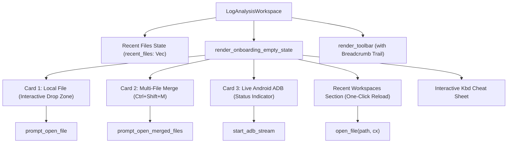

# 💎 Technical Specification: Professional UI Polish - Phase 2 (Welcome Workspace & Layout)

**Document ID:** `spec-ui-professional-phase2`  
**Target:** `crates/loganalysis-gui`  
**Phase:** Phase 1: Architecture & Layout Specification  
**Status:** APPROVED_FOR_GOAL_EXECUTION  

---

## 1. Executive Summary & Goals

Phase 2 builds upon the typography and elevation tokens introduced in Phase 1 to transform the initial user experience and workspace layout of **LogAnalysis**:
1. **Linear / Zed-Grade Welcome & Onboarding Workspace**:
   - Replaces the basic onboarding box with an elevated, 3-pillar action grid:
     1. **Local Log File (`Ctrl+O`)**: Interactive drag-and-drop zone (click-to-browse, dashed hover surface).
     2. **Multi-File Interleaved Merge (`Ctrl+Shift+M`)**: Dedicated entry point for chronologically merging multiple log streams.
     3. **Live Android ADB Stream (`Ctrl+R`)**: Live device status indicator, serial/model info, and one-click streaming.
   - **Recent Files History**:
     - Displays recently opened log files with file name, abbreviated path, and one-click instant reload.
     - Persists history automatically to `~/.config/loganalysis/recent_files.json`.
   - **Interactive Keyboard Cheat Sheet**:
     - Modern keyboard pill chips (`render_kbd_badge`) for primary shortcuts (`Ctrl+O`, `Ctrl+P`, `Ctrl+F`, `F`, `Ctrl+\`, `Ctrl+Shift+M`, `Ctrl+B`).
2. **Compact Toolbar & Contextual Breadcrumb Navigation**:
   - Polished breadcrumb hierarchy (`📄 File > Line Count > Filter Status`) embedded in the toolbar/header.
   - Secondary pane empty state (`render_secondary_empty_state`) upgraded to match the 4-tier elevation aesthetic.

---

## 2. Component Architecture & Data Flow

---

## 3. Detailed Component Specifications

### 3.1 Recent Files Persistence (`crates/loganalysis-gui/src/workspace.rs`)
* Store `pub recent_files: Vec<std::path::PathBuf>` in `LogAnalysisWorkspace`.
* On startup, load from `~/.config/loganalysis/recent_files.json` if available.
* In `open_file`: prepend opened file path, deduplicate, truncate to 5 items, and persist asynchronously or atomically.
* Add helper `pub fn open_recent_file(&mut self, path: std::path::PathBuf, cx: &mut Context<Self>)`.

### 3.2 Enhanced Welcome Workspace (`crates/loganalysis-gui/src/components/log_view.rs`)
* **Card 1: Local File**:
  - Clickable drag-and-drop target zone `.cursor_pointer()` that invokes `prompt_open_file`.
  - Glassy top highlight inset (`border_highlight`) and `shadow_lg()`.
* **Card 2: Multi-File Merge**:
  - Highlights k-way chronological interleaving with stack trace preservation.
  - Action button: `prompt_open_merged_files(Some(window), cx)`.
* **Card 3: Live ADB**:
  - Status indicator (Ready / Unauthorized / Scanning), device model and serial badge, and one-click stream button.
* **Recent Files Shelf**:
  - List of up to 5 recent files with file size or path, hover highlighting, and one-click loading.
* **Secondary Empty State (`render_secondary_empty_state`)**:
  - Modernized with matching elevation tokens, quick file open button, and swap panes button.

### 3.3 Toolbar Breadcrumb Trail (`crates/loganalysis-gui/src/components/toolbar.rs`)
* When an active log or stream is present, render a clean breadcrumb pill:
  - Icon + File/Device name
  - Separator chevron `>`
  - Line count with monospace tabular font
  - Filter match count badge if filters are active

---

## 4. Verification & QA Plan

1. **Compilation**: `cargo clippy --workspace --all-targets` with 0 warnings.
2. **Unit Tests**: Add tests for recent files serialization/deserialization and empty state components.
3. **Regression Tests**: All 103 existing tests continue to pass.
4. **Invariant Check**: Invariants `[INV-01]` through `[INV-15]` in `docs/INVARIANTS.md` must stay 100% compliant.
