# 💎 Technical Specification: Professional UI Redesign & Polish (Zed / Linear Grade)

**Document ID:** `spec-ui-professional-redesign`  
**Target:** `crates/loganalysis-gui` & `crates/loganalysis-core`  
**Phase:** Phase 1: Discovery & Architecture Specification  
**Status:** AWAITING_USER_APPROVAL  

---

## 1. Executive Summary & Problem Statement

**LogAnalysis** features a cutting-edge backend: zero-copy memory-mapped ingestion (`memmap2`), multi-threaded SIMD regex filtering (`rayon`), and 120 FPS+ GPU rendering (`uniform_list` via GPUI). However, its visual presentation retains legacy patterns common in desktop tools:
- Buttons embed raw text shortcuts (e.g., `"Open (Ctrl+O)"`, `"Filter Mode (F)"`).
- Surfaces lack systematic 4-tier visual elevation (Zed/Linear style layer hierarchy).
- Android Logcat tags are rendered uniformly without visual distinction, hindering rapid log triage.
- Severity levels (V/D/I/W/E/F) are either full-row color overrides or plain text, without modern micro-badge styling.

This specification defines the architectural and visual redesign to transform LogAnalysis into an **Apple/Zed/Linear-grade professional developer tool**.

---

## 2. Design System & Design Tokens (`theme.rs`)

### 2.1 Four-Tier Surface Elevation Model

| Layer | Dark Mode Token | Light Mode Token | Intended Usage |
| :--- | :--- | :--- | :--- |
| **Layer 0 (Canvas Base)** | `#0e0f14` (`bg_canvas`) | `#f8fafc` | Global window background and CSD titlebar |
| **Layer 1 (Panels & Docks)** | `#13141b` (`bg_panel`) | `#f1f5f9` | Filter dock, status bar, timeline container |
| **Layer 2 (Viewport / Content)** | `#171821` (`bg_viewport`) | `#ffffff` | Primary log list, active file container |
| **Layer 3 (Cards & Floating)** | `#1e202c` (`bg_card`) | `#f8fafc` | Filter rule cards, modal dialogs, popovers |
| **Layer 4 (Interactive Pill)** | `#262938` (`bg_badge`) | `#e2e8f0` | Kbd shortcuts, match badges, search chips |

### 2.2 Micro-Border & Contrast Strategy
- Structural Dividers: `rgba(255, 255, 255, 0.08)` (Dark) / `rgba(0, 0, 0, 0.08)` (Light).
- Subtle Inner Borders: `rgba(255, 255, 255, 0.04)` (Dark) / `rgba(0, 0, 0, 0.04)` (Light).
- Focus Ring: Vibrant electric blue `#3b82f6` with 1.5px subtle glow.

---

## 3. Component Architecture & Visual Specifications

```mermaid
graph TD
    A[LogAnalysis Professional UI] --> B[1. Design Tokens & Theme]
    A --> C[2. Toolbar & Segmented Controls]
    A --> D[3. Log Viewport & Typography]
    A --> E[4. Filter Dock & Rule Cards]
    A --> F[5. Status Bar & Micro-Indicators]

    B --> B1[4-Tier Surface Elevation]
    B --> B2[Kbd Shortcut Pill Tokens]
    B --> B3[Logcat Severity Palette]

    C --> C1[Clean Action Buttons + Kbd Chips]
    C --> C2[Segmented View Pill: All / Filtered]
    C --> C3[Connected Device Status Glow]

    D --> D1[Deterministic Tag Color Hashing]
    D --> D2[Severity Micro-Badges: V/D/I/W/E/F]
    D --> D3[Tabular Gutter Numbers with Accent Marker]

    E --> E1[Switch Toggle Controls]
    E --> E2[Filter Rule Match Count Badges]
    E --> E3[Color Swatch Badges]

    F --> F1[Indexing / Filter Throughput Badge]
    F --> F2[Streaming Heartbeat Pulse]
```



### 3.1 Modernized Toolbar (`toolbar.rs`)
1. **Shortcut Micro-Kbd Pills**:
   - Replace `"Open (Ctrl+O)"` with a flex container:
     - Text: `"Open"`
     - Kbd Chip: `div().px(4px).py(1px).rounded_sm().bg(theme.bg_badge).text_size(9.5px).child("Ctrl O")`
2. **Segmented Control for View Modes**:
   - Merge `All (F)` and `Filtered (F)` into a single macOS/Zed-style segmented pill container:
     ```
     [  All Lines  |  Filtered Only  ]
     ```
   - Smooth active indicator highlighting the selected segment.
3. **Device Streamer Dropdown**:
   - Pulse indicator (green dot `#34d399`) showing active ADB streaming state.

### 3.2 High-Density Log Viewport & Gutter (`log_view.rs`)
1. **Deterministic Tag Color Hashing**:
   - Android Logcat tags (`ActivityManager`, `SurfaceFlinger`, `InputDispatcher`, etc.) are hashed deterministically:
     $$\text{hash} = \sum_{i} c_i \times 31^{n-1-i} \pmod{8}$$
   - Mapped to a curated palette of 8 pastel colors (Teal, Sky, Indigo, Lavender, Rose, Emerald, Amber, Mint) ensuring high readability against dark/light backgrounds.
2. **Severity Badges (V, D, I, W, E, F)**:
   - In structured and line views, render a 18x18px rounded micro-badge:
     - `V` (Verbose): Muted Slate (`#64748b`)
     - `D` (Debug): Cyan (`#06b6d4`)
     - `I` (Info): Emerald (`#10b981`)
     - `W` (Warning): Amber (`#f59e0b`)
     - `E` (Error): Coral Red (`#ef4444`)
     - `F` (Fatal): Magenta (`#ec4899`)
3. **Gutter & Tabular Numbers**:
   - Fixed width line number gutter with `FontWeight::NORMAL` and tabular figure spacing (`tnum`).
   - Line selection indicator: 2px colored accent bar on the leftmost gutter border for the active cursor row.

### 3.3 Modernized Filter Dock & Cards (`filter_dock.rs`)
1. **Card Hierarchy**:
   - 1px subtle border, rounded-lg (`8px`), padded hover state.
2. **Switch Controls**:
   - Replace standard checkmarks with sleek iOS/Linear toggle switches or rounded pill toggles.
3. **Matched Lines Pill**:
   - Display matched lines count (e.g. `2.4k`) directly on each active filter card.

### 3.4 Status Bar (`status_bar.rs`)
1. **Performance Telemetry**:
   - Display engine metrics in discrete chips:
     `[ ⚡ 1.2M lines (14ms) ]`  `[ 120 FPS Vulkan ]`  `[ 200k Buffer ]`
2. **Status Pills**:
   - Interactive theme switch icon button (`☀` / `🌙`), font scaling controls (`-` / `+`), and shortcut guide button (`?`).

---

## 4. Edge Cases & Safety Invariants

1. **GPU Rendering Throughput**:
   - Micro-badges and color hashing must not allocate strings or vectors in the `uniform_list` item render closure.
   - Tag hashing must use `&str` slices and static color arrays (`[Rgba; 8]`).
2. **Zero Invalidation of Core Filtering**:
   - Core SIMD filtering and regex matching logic remain untouched.
   - All visual enhancements are pure GPUI view-layer transformations.
3. **Contrast Compliance**:
   - All severity badges and hashed tag colors must meet WCAG 2.1 AA minimum contrast ($\ge 4.5:1$).

---

## 5. Verification & Test Plan

1. **Unit Testing**:
   - Add unit tests in `loganalysis-core` / `loganalysis-gui` validating deterministic tag color hashing distribution.
   - Validate WCAG contrast safety for all newly introduced theme tokens.
2. **Compilation & Static Checks**:
   - `cargo check --workspace`
   - `cargo test --workspace`
3. **Execution & Regression Testing**:
   - Verify layout stability on both 1080p and 4K HiDPI displays.
   - Confirm split-view, column view, and bookmark drawer operate with the new design tokens.
