# 🎨 Technical Specification: Comprehensive UI/UX Polish

**Document ID:** `spec-ux-polish`  
**Target:** `crates/loganalysis-gui` & `crates/loganalysis-core`  
**Phase:** Phase 1: Discovery & Architecture Specification  
**Status:** AWAITING_USER_APPROVAL  

---

## 1. Executive Summary & Objectives

The LogAnalysis application provides high-performance SIMD log filtering and Rayon multi-threaded indexing with a GPUI-based virtualized renderer. Following recent P0–P2 stability milestones (SIMD engine isolation, IME input handling, X11 modal robustness, and line caching), this specification addresses the interactive ergonomics, visual affordances, and micro-interactions across the entire user experience.

The key objectives of this UI/UX Polish pass:
1. **Interactive Feedback & Hover Transitions**: Add complete hover, active, and focus states across all interactive buttons, segmented controls, and toggle pills in the toolbar, find bar, filter dock, and modal dialogs.
2. **Search Feedback & Match Counter in Find Bar**: Add a live search match counter badge (e.g. `1 of 24` or `0 matches`) and inline query clear button (`✕`) in the Find Bar.
3. **Filter Dock Empty States & Search Ergonomics**: Provide empty-state cards when tabs have 0 rules or when search filtering yields 0 matches, along with refined rule card styling, high-contrast badges, and smooth reordering.
4. **Log View Line & Gutter Affordances**: Provide an active line accent marker in the gutter, selected line number highlighting, and enhanced copy toast feedback.
5. **Modal Ergonomics & Keyboard Accessibility**: Enable `Enter` to commit and `Escape` to cancel inside the Filter Edit Modal, alongside a quick-preset color palette grid for common log levels (Error, Warn, Info, Debug, Trace).
6. **Dark & Light Theme Visual Harmony**: Harmonize contrast ratios, subtle borders, and badge backgrounds across both TokyoNight-inspired dark mode and clean daylight studio mode.

---

## 2. Component-by-Component Polish Plan

```mermaid
graph TD
    A[UI/UX Polish Scope] --> B[1. Toolbar & Controls]
    A --> C[2. Find Bar & Search]
    A --> D[3. Filter Dock & Tabs]
    A --> E[4. Log View & Gutter]
    A --> F[5. Filter Edit Modal]
    A --> G[6. Theme System]

    B --> B1[Hover / active feedback on all buttons]
    B --> B2[Shortcut micro-badges on hover / display]
    B --> B3[Rich active file / ADB stream badge]

    C --> C1[Live Match Count pill in Find Bar]
    C --> C2[Clear button '✕' in Find Input]
    C --> C3[Enter / Shift+Enter / Esc keyboard navigation]

    D --> D1[Friendly empty state when 0 rules]
    D --> D2[Empty query match feedback]
    D --> D3[Refined rule card swatches and hover states]

    E --> E1[Active row gutter highlight indicator]
    E --> E2[Enhanced copy feedback toast]
    E --> E3[Refined empty state card]

    F --> F1[Enter to Save / Esc to Cancel]
    F --> F2[Log level color presets: Err, Warn, Info, Debug]
    F --> F3[WCAG AA / AAA contrast badge clarity]

    G --> G1[WCAG AA contrast tuning across dark/light themes]
```

---

### Component 1: Toolbar & Header Controls ([`toolbar.rs`](file:///home/drew/github/hwanjongyu/loganalysis/crates/loganalysis-gui/src/components/toolbar.rs))

1. **Button Hover & Active Feedback**:
   - `btn-toolbar-open`: Add `.hover(|s| s.bg(theme.accent.opacity(0.85)))` or brightened accent.
   - `seg-all-lines` / `seg-filtered-only`: Add `.hover(|s| s.bg(theme.btn_hover))` for inactive state.
   - `btn-toolbar-full-line`, `btn-toolbar-auto-scroll`, `btn-toolbar-filter-dock`: Add consistent hover transitions for both active and inactive states.
   - `btn-toolbar-adb`: Add hover state distinguishing Live (`theme.success_green` hover) vs Stop (`theme.error_red` hover).
2. **Keyboard Shortcut Badges**:
   - Add subtle shortcut badges in toolbar buttons:
     - Open: `Ctrl+O`
     - All / Filtered: `Ctrl+H`
     - Clear: `Ctrl+K`
     - Find: `Ctrl+F`
     - Dock: `Ctrl+Shift+L`
3. **Active File Badge Polish**:
   - Display file size / line count telemetry or subtle file extension badge when loaded.

---

### Component 2: Find Bar ([`find_bar.rs`](file:///home/drew/github/hwanjongyu/loganalysis/crates/loganalysis-gui/src/components/find_bar.rs))

1. **Match Counter Badge**:
   - Add a live match counter pill next to the search input displaying:
     - `Match X of Y` when a match is selected.
     - `No matches` (in muted amber/red) when pattern produces zero hits.
     - Muted counter when search query is empty.
2. **Inline Clear Button**:
   - Show an inline `✕` button inside/adjacent to the Find Bar `TextInput` to quickly clear the search query.
3. **Button Hover States**:
   - Add `.hover(|s| s.bg(theme.btn_hover))` to `btn-find-regex`, `btn-find-case`, `btn-find-prev`, `btn-find-next`, and `btn-find-close`.

---

### Component 3: Filter Dock & Rules Management ([`filter_dock.rs`](file:///home/drew/github/hwanjongyu/loganalysis/crates/loganalysis-gui/src/components/filter_dock.rs))

1. **Empty State Guidance**:
   - When active tab has no rules (`tab.filters.is_empty()`), show an inviting empty state container:
     - Icon: `🎯` or `🎨`
     - Title: `No Active Filter Rules`
     - Hint: `Click "+ New Rule" (Ctrl+Shift+F) or select text in the log and press "+ Filter Sel".`
2. **Zero-Match Search Filter Feedback**:
   - When searching filter rules with `filter_search_query` and 0 rules match, render:
     - `No filter rules match "<query>"` with a clickable `Clear Search (✕)` link.
3. **Rule Cards Affordance Polish**:
   - Swatch border and contrast enhancement.
   - Hover states for reorder `▲`/`▼`, edit `✎`, and delete `✕` buttons with accent highlighting on hover.
   - Match count pill background with subtle border for high legibility.

---

### Component 4: Log View & Gutter ([`log_view.rs`](file:///home/drew/github/hwanjongyu/loganalysis/crates/loganalysis-gui/src/components/log_view.rs))

1. **Active Gutter Indicator**:
   - Highlight the line number in the gutter when the row is selected (`theme.accent` text color).
   - Add a subtle 2px accent indicator bar on the left border of the selected row.
2. **Scrollbar Thumb Refinement**:
   - Smooth hover transition with rounded caps and proper contrast in both light and dark themes.
3. **Empty State Polish**:
   - Modernize the onboarding card with clear keyboard shortcut cheat sheet formatting and quick action buttons.

---

### Component 5: Filter Edit Modal ([`filter_edit_modal.rs`](file:///home/drew/github/hwanjongyu/loganalysis/crates/loganalysis-gui/src/modals/filter_edit_modal.rs))

1. **Keyboard Accessibility**:
   - `Enter` commits the filter rule and closes modal (calling `save_filter_from_modal`).
   - `Escape` dismisses without saving (calling `close_filter_modal`).
2. **Color Preset Palette**:
   - Quick one-click log level presets:
     - 🔴 **ERROR**: Background `#450a0a` / `#fee2e2`, Foreground `#ef4444` / `#b91c1c`
     - 🟡 **WARN**: Background `#451a03` / `#fef3c7`, Foreground `#f59e0b` / `#d97706`
     - 🔵 **INFO**: Background `#172554` / `#dbeafe`, Foreground `#3b82f6` / `#2563eb`
     - 🟣 **DEBUG**: Background `#3b0764` / `#f3e8ff`, Foreground `#a855f7` / `#7e22ce`
     - ⚪ **TRACE**: Background `#18181b` / `#f4f4f5`, Foreground `#a1a1aa` / `#71717a`
3. **WCAG Contrast Badge Polish**:
   - Visual AAA / AA / Low-contrast badge with dynamic pill color matching accessibility standards.

---

### Component 6: Theme Refinement ([`theme.rs`](file:///home/drew/github/hwanjongyu/loganalysis/crates/loganalysis-gui/src/theme.rs))

1. **TokyoNight / Zed Dark Mode**:
   - Deep obsidian background (`#111116`), crisp borders (`#292936`), electric blue accent (`#3b82f6`).
2. **Clean Daylight Studio Light Mode**:
   - Soft white canvas (`#ffffff`), neutral borders (`#e2e8f0`), deep blue accent (`#2563eb`).
3. **Contrast Compliance**:
   - Verify all muted text and badge labels meet minimum WCAG 2.1 AA (4.5:1) against their container backgrounds.

---

## 3. Structural Invariants & Non-Regression Guarantees

All changes must strictly adhere to the project invariants documented in [`docs/INVARIANTS.md`](file:///home/drew/github/hwanjongyu/loganalysis/docs/INVARIANTS.md):
- **`[INV-01-B]`**: Maintain X11 modal safety and prevent GPUI window handle panic.
- **`[INV-02-B]`**: Zero blocking I/O on UI main thread.
- **`[INV-04]`**: Maintain CJK 2-column monospace width formatting.
- **`[INV-08-A]` & `[INV-08-B]`**: Maintain UTF-16/UTF-8 IME boundary safety in text inputs.
- **`[INV-11]`**: Strictly preserve WCAG AA contrast verification.

---

## 4. Verification & QA Plan

1. **Unit & Integration Tests**:
   - Run `cargo test --workspace` ensuring all 51 tests pass.
   - Add unit tests for shortcut mappings, filter rule color presets, and match counter calculations.
2. **Linter & Formatting**:
   - Run `cargo clippy --workspace --all-targets` with 0 warnings.
   - Run `cargo fmt --check`.
3. **Interactive Validation**:
   - Verify hover states across all toolbar buttons and controls.
   - Test empty states in filter dock and log viewport.
   - Test `Enter` and `Escape` keyboard shortcuts in Filter Edit Modal.
   - Test match counter updates in Find Bar.

---

## 5. Next Step

Upon user approval of this specification (`docs/spec-ux-polish.md`), execution will proceed to **Phase 2: Implementation & QA Loop**.
